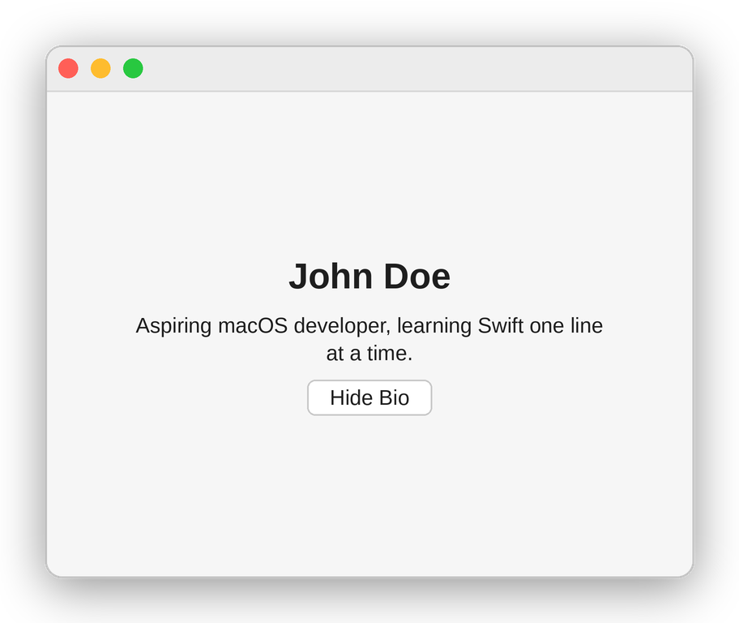
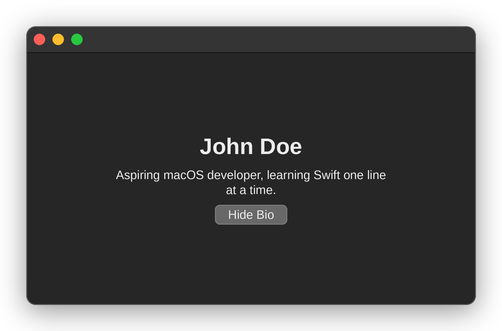
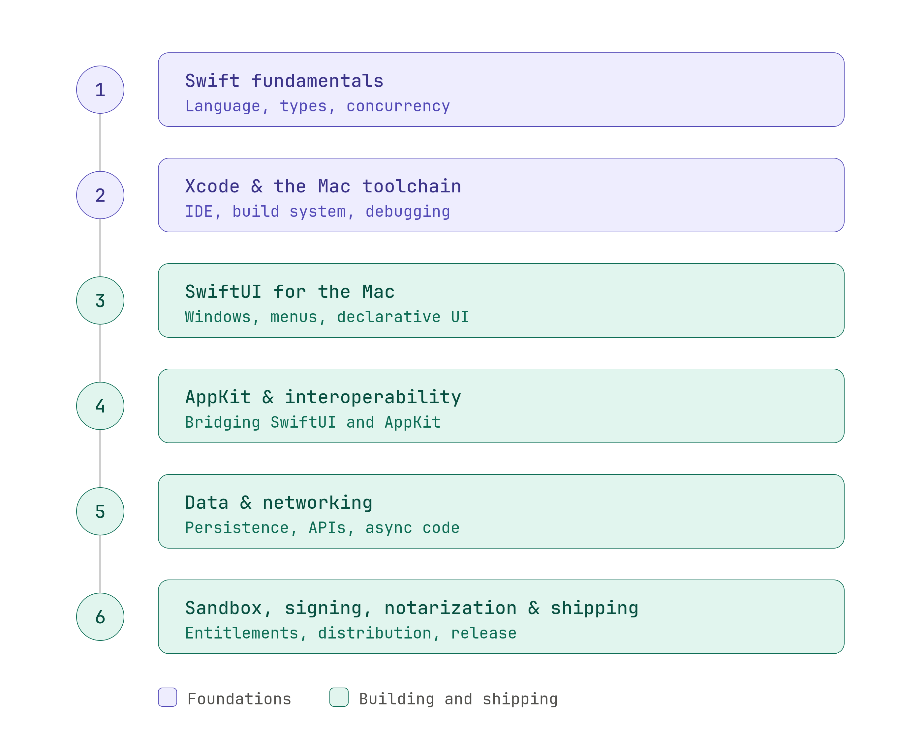

If you've read the [Desktop App Developer post](https://dynamicbytes.blog/how-to-become-a-desktop-app-developer-2026/) and the quiz pointed you here - or you already knew the Mac was your lane before you got anywhere near a quiz - this is the full, deep breakdown. Everything shared across desktop platforms was already covered there, and the [Windows post](https://dynamicbytes.blog/how-to-become-a-windows-developer-2026/) covers the other big desktop platform in the same depth. This post is entirely about what's specific to building for the Mac.

One thing worth clearing up first: this post is about **native** macOS development - Swift and Apple's own frameworks. If what you actually had in mind is one codebase that runs on Windows, macOS, and Linux using web technologies like Electron or Tauri, that's cross-platform desktop development, and it gets its own dedicated [post](https://dynamicbytes.blog/coming-soon/) on this blog.

This post is also fully standalone. If you've read the [iOS post](https://dynamicbytes.blog/how-to-become-an-ios-developer-2026/), some of the Swift and Xcode basics below will look familiar, and that's deliberate - you shouldn't need to read two posts to get one complete picture.

Let's get right into it.

---

## What Is macOS Development?

Here's the picture to hold on to: **a Mac app is a guest in a building Apple owns - and Apple designed the building, the furniture, and the house rules.** The building provides the rooms (windows, menus, files, notifications) through a huge set of frameworks. Your language and UI framework are how you furnish the room you've been given, and the way you ship your app is how you get the keys.

Every piece of that picture has a name:

**Swift** is the language - a modern, safe, compiled language created by Apple and the default choice for new Mac apps in 2026. If you've followed this blog's [back-end roadmap](https://dynamicbytes.blog/how-to-get-into-backend-development-2026/) and learnt Java, or built anything in the [Android post](https://dynamicbytes.blog/how-to-become-an-android-developer-2026/)'s Kotlin, a lot of Swift's ideas will feel familiar. More on that in the FAQ.

**SwiftUI and AppKit** are the two UI frameworks you'll meet. SwiftUI is the modern one, and AppKit is the long-established one underneath it. Most of the next sections are spent on how they relate, because that relationship is the heart of macOS development today.

**Xcode** is Apple's IDE and the home of almost all Mac development - your editor, interface tooling, debugger, live previews, and packaging all live inside it. It is free, and it runs only on a Mac.

**The Mac App Store** is one way to distribute a Mac app, but, as on Windows, it's very much not the only way. You can also ship a download directly to users, provided you sign it with Apple and have Apple scan it first - a process called notarization. Both routes get their own section later in this post.

---

## Why macOS Matters in 2026

**The honest starting point:** the Mac is a smaller slice of the world's desktops than Windows is. What it lacks in raw count it makes up for in concentration. A lot of design, creative, development, and professional-services work happens on Macs, and the users on that platform tend to notice - and care about - whether an app feels native.

That pairing is what shapes the work. Mac software is often **polish-driven**: small utilities, writing and note-taking tools, creative software, developer tools, and professional apps where the quality of the experience is the product. If your idea of good work is an app that feels like it belongs on the system, this is a natural fit.

> **Heads up:** macOS development is really Apple-platform development. Swift, SwiftUI, Xcode and your Apple Developer account are shared across Mac, iPhone and iPad, so Mac-only job listings tend to be rarer than Apple-platform ones that include a Mac app. Treat macOS as your way into the whole ecosystem, and expect to pick up iOS too. Our [iOS post](https://dynamicbytes.blog/how-to-become-an-ios-developer-2026/) is the natural next step.

**The honest cost:** macOS development is Mac-only. Your app won't run on Windows or Linux, and - unlike Windows development, where almost any PC will do - the machine you build on has to be an Apple computer. That requirement got stricter this year, and it gets its own section below.

**The verdict:** macOS development is a strong, stable path in 2026 for people who care about craft and want to work inside a tightly integrated ecosystem. It rewards attention to detail and a willingness to follow Apple's design conventions. If you want the widest possible consumer reach in one codebase, mobile or cross-platform will serve you better; if you want to build software that feels right on one platform, this is the place.

---

## SwiftUI, AppKit, and Mac Catalyst: The Honest Breakdown

Three ways to build a Mac interface, from three different eras. Here's how they relate.

### SwiftUI

SwiftUI arrived in 2019 and is Apple's modern UI framework. You write declarative code: Instead of creating buttons and changing their properties step by step, you describe what the screen should look like for a given state, and SwiftUI redraws it whenever that state changes. It works on Mac, iPhone, iPad, Apple Watch, and Apple TV, which is a large part of why it leads this post - the same skills carry across the whole ecosystem.

**Why it leads this post:** It's where Apple is putting its energy, it's what most new Mac apps are started in, and it's the fastest route from nothing to a working app. Learning it also gives you the shared Apple-platform skill the sidebar above was talking about.

**The honest trade-offs:** SwiftUI is younger than the Mac's native toolkit, and some Mac-specific behaviours - fine control over windows, complex text editing, certain menu and toolbar details - are either missing or easier to get right in AppKit. Respected Mac developers still report that building a truly Mac-native feel in SwiftUI takes extra effort. That is manageable, because the two frameworks are designed to be mixed.

### AppKit

AppKit is the Mac's original native UI toolkit, and it has been the foundation of Mac apps for more than two decades. It's imperative: you create interface objects, set their properties, and update them yourself when something changes. It's more verbose than SwiftUI, but it gives you control over nearly every detail of how a Mac app behaves.

**This is not a legacy footnote.** A large amount of existing professional Mac software is written in AppKit, and SwiftUI itself is built on top of it. If you ever join a team with an established Mac app, you will almost certainly meet AppKit code. And because the frameworks interoperate - SwiftUI views can be hosted inside AppKit (with `NSHostingView`) and AppKit views can be used inside SwiftUI (with `NSViewRepresentable`) - real apps often use both.

**The honest trade-off:** It has a steeper learning curve and far more boilerplate, and tutorials for it can be older than the APIs they describe.

### Mac Catalyst

Mac Catalyst lets you take an **iPad app** built with UIKit and bring it to the Mac. It exists for one situation: You already have an iPad app and want a Mac version without starting again. If you're learning Mac development from scratch, it isn't where you start, and it tends to produce apps that feel like iPad apps on a Mac unless you invest effort to make them feel native. Know it exists, and know why.

### The Verdict

**Learn SwiftUI first, then AppKit as a second dialect.** SwiftUI and AppKit are like two regional accents of the same language: The concepts - windows, views, events, the app lifecycle - carry across, and what changes is the style of writing. Once you can build a Mac app in SwiftUI, learning where AppKit fills the gaps is mostly a matter of recognising which problems need it. You'll come out of it able to build new apps and to work in older codebases.

---

## Which One Should You Learn?

The tree below is the short version of everything above, shaped as a few questions. Follow the branch that matches your situation, and click a leaf to jump to the matching section.

<div class="dtree-wrapper">
  <ul class="dtree">
    <li>
      <span class="dtree-node dtree-node-plain">Building something new, or joining an existing app?</span>
      <ul>
        <li>
          <span class="dtree-node dtree-node-leaf">
            Existing app
            <span class="dtree-sub">Learn whatever it's built on - AppKit for older apps, SwiftUI for newer ones</span>
          </span>
        </li>
        <li>
          <span class="dtree-node dtree-node-plain">New app: does it need to run on Windows or Linux too?</span>
          <ul>
            <li>
              <a href="/coming-soon/" class="dtree-node dtree-node-leaf">
                Yes
                <span class="dtree-sub">Cross-Platform Desktop</span>
                <span class="dtree-badge">Coming Soon</span>
              </a>
            </li>
            <li>
              <span class="dtree-node dtree-node-plain">No, Mac only: what matters most?</span>
              <ul>
                <li>
                  <a href="#swiftui" class="dtree-node dtree-node-leaf">
                    Fastest start, a modern codebase, skills that carry to iPhone and iPad
                    <span class="dtree-sub">SwiftUI</span>
                  </a>
                </li>
                <li>
                  <a href="#appkit" class="dtree-node dtree-node-leaf">
                    Fine control over Mac-specific behaviour, or joining an older codebase
                    <span class="dtree-sub">AppKit</span>
                  </a>
                </li>
                <li>
                  <a href="#mac-catalyst" class="dtree-node dtree-node-leaf">
                    I already have an iPad app and want it on the Mac
                    <span class="dtree-sub">Mac Catalyst</span>
                  </a>
                </li>
              </ul>
            </li>
          </ul>
        </li>
      </ul>
    </li>
  </ul>
</div>

<p class="dtree-caption">Click any leaf to jump to that section - or, for the cross-platform branch, to the guide that's coming next.</p>

<style>
.dtree-wrapper {
  margin: 2rem 0 0.5rem;
  padding: 1.5rem 1rem;
  border: 1px solid var(--border);
  border-radius: 8px;
  background: var(--surface);
  overflow-x: auto;
}

.dtree, .dtree ul {
  position: relative;
  padding-top: 1.75rem;
  display: flex;
  justify-content: center;
  margin: 0;
}

.dtree {
  padding-top: 0;
}

.dtree li {
  list-style-type: none;
  position: relative;
  padding: 1.75rem 0.75rem 0;
  text-align: center;
}

.dtree > li {
  padding-top: 0;
}

.dtree li::before,
.dtree li::after {
  content: '';
  position: absolute;
  top: 0;
  right: 50%;
  width: 50%;
  height: 1.75rem;
  border-top: 2px solid var(--border);
}

.dtree li::after {
  right: auto;
  left: 50%;
  border-left: 2px solid var(--border);
}

.dtree li:only-child::before,
.dtree li:only-child::after {
  display: none;
}

.dtree li:only-child {
  padding-top: 0;
}

.dtree li:first-child::before {
  border: none;
}

.dtree li:last-child::after {
  border-top: none;
}

.dtree li:first-child::after {
  border-radius: 0;
}

.dtree li:last-child::before {
  border-radius: 0;
}

.dtree ul::before {
  content: '';
  position: absolute;
  top: 0;
  left: 50%;
  border-left: 2px solid var(--border);
  width: 0;
  height: 1.75rem;
}

.dtree-node {
  display: inline-flex;
  flex-direction: column;
  align-items: center;
  gap: 0.35rem;
  background: var(--bg);
  border: 1px solid var(--border);
  border-radius: 6px;
  padding: 0.6rem 0.9rem;
  font-family: 'Inter', sans-serif;
  font-size: 0.88rem;
  font-weight: 600;
  color: var(--text);
  text-decoration: none;
  white-space: nowrap;
  transition: border-color 0.2s ease, transform 0.15s ease;
}

a.dtree-node:hover {
  border-color: var(--accent);
  transform: translateY(-2px);
}

.dtree-node-plain {
  color: var(--accent);
  cursor: default;
  font-size: 1.05rem;
}

.dtree-node-leaf {
  font-size: 0.85rem;
  font-weight: 500;
  color: var(--text-muted);
}

.dtree-badge {
  font-size: 0.62rem;
  font-weight: 600;
  text-transform: uppercase;
  letter-spacing: 0.04em;
  color: var(--text-muted);
  border: 1px solid var(--border);
  border-radius: 4px;
  padding: 0.1rem 0.4rem;
}

.dtree-badge-live {
  color: var(--accent);
  border-color: var(--accent);
}

.dtree-caption {
  text-align: center;
  font-size: 0.85rem;
  color: var(--text-muted);
  margin-top: 0.5rem;
}

/* Windows post additions: allow question/answer text to wrap, add a sub-label */
.dtree-node {
  white-space: normal;
  max-width: 11rem;
}

.dtree-node-plain {
  font-size: 0.9rem;
}

.dtree-sub {
  font-size: 0.75rem;
  font-weight: 600;
  color: var(--accent);
}
</style>

---

## Which Mac Do You Need?

Here's the part of macOS development with no Windows equivalent. **Xcode only runs on macOS, and macOS only legitimately runs on Apple hardware.** Think of it like learning to drive: You can read as many books as you like, but you can't practise in a car that doesn't exist. This year, which car matters more than it used to.

### What Changed in 2026

macOS 27 "**Golden Gate**" is the first macOS release that runs only on Apple silicon Macs, and Xcode 27 is Apple-silicon-only too. According to Apple's own Xcode 27 release notes, Xcode 27 "will only install and run on Apple silicon Macs." Some Intel Macs can still run macOS Tahoe (macOS 26), which was the last release to support Intel, but they stop there.

### Your Situation, Your Options

| Your Mac | What you can do |
| -------- | --------------- |
| **Apple silicon Mac (M1 or later)** | Everything. Xcode 27, macOS 27, and the newest SDKs |
| **Intel Mac that can run macOS Tahoe** | Xcode 26.6, which supports macOS Tahoe and uses Swift 6.3. Plenty for learning Swift, SwiftUI, and AppKit, but it can't run Xcode 27 |
| **Older Intel Mac** | An older Xcode tied to the older macOS your machine can run. You can still learn the language, but you'll fall further behind the current SDK |
| **No Mac at all** | A rented cloud Mac - see the tip below |

> **Quick tip: borrowed, older, or rented Macs**
>
> You don't have to buy a new Mac on day one, so here are the realistic routes:
>
> - **Borrow or share one** while you're learning the fundamentals. Swift itself and the first stages of the roadmap work fine on a borrowed or older machine.
> - **Check the chip before you buy.** If you're purchasing, an Apple silicon Mac (M1 or later) is the safe choice, because it runs the current Xcode.
> - **Rent a Mac in the cloud.** Services such as MacinCloud, MacStadium, AWS EC2 Mac, and Scaleway let you rent a Mac and connect to it remotely. Prices and plans change, so compare current ones yourself. One licence detail worth knowing: Apple requires a 24-hour minimum on cloud Mac rentals, so expect to pay for at least a day. Test the connection before committing - coding over a remote desktop is only pleasant if the latency is low.
> - **Don't try a "Hackintosh".** Apple's macOS licence only permits macOS on Apple-branded hardware, so it isn't a legitimate route, and it tends to break with every update.
>
> Check Xcode's current download size and system requirements on Apple's site before you buy or rent, so you leave yourself enough room.

### Targeting Your Users' Macs

Separate from the Mac *you* build on is the question of which Macs your *users* have, and here the instinct to pick one macOS version and stop is the wrong one. Think of it as choosing the lowest floor your lift will serve: set it too high and some of your users can't get in.

The better approach is to make your app backward-compatible. In Xcode, your project's deployment target is the oldest macOS version you promise to support. According to Apple's compatibility table, Xcode 27 can target macOS 12 through 27, so you can build with the newest tools and still run on older Macs. Two details worth knowing:

- **Don't assume everyone upgrades:** Trackers disagree on the exact split, but all of them show a meaningful minority of Macs on older macOS versions. And because Intel Macs can't go past macOS 26, those users are on an older version for good.
- **The deployment target also decides whether Intel Macs can run your app:** Apple's release notes say the macOS 27 SDK still supports back-deploying Universal (Intel and Apple silicon) apps to macOS 12 and later, but Xcode stops building the Intel part by default once your deployment target reaches macOS 27. Set it lower if you want to reach Intel users.

When a newer feature is only available on recent macOS versions, Swift lets you check at runtime with `#available` and fall back gracefully, so one app can offer the newest features where they exist and still work elsewhere.

---

## Building Your First Screen

Enough theory - let's build the same simple screen two different ways, so the difference between SwiftUI and AppKit is something you feel, not just read about.

By the end of this section you'll have a small profile card - a name, a bio, and a button that toggles the bio's visibility - in both frameworks. If you've read the [front-end post](https://dynamicbytes.blog/what-is-frontend-development-2026/), the [Android post](https://dynamicbytes.blog/how-to-become-an-android-developer-2026/), or the [Windows post](https://dynamicbytes.blog/how-to-become-a-windows-developer-2026/), you'll recognise the exact same card; same result, completely different toolkit.

**Setup:** install Xcode from the Mac App Store (it's free). In Xcode, choose **File > New > Project**, pick **macOS > App**, name it `ProfileCard`, and set the language to Swift. For the SwiftUI version, set **Interface** to **SwiftUI**. For the AppKit version, create a second project and set **Interface** to **Storyboard**. The exact option names shift slightly between Xcode versions, so if yours differs, choose the closest equivalents.

### The SwiftUI Way

`ContentView.swift`:

```swift
import SwiftUI

struct ContentView: View {
    @State private var showBio = true

    var body: some View {
        VStack(spacing: 8) {
            Text("John Doe")
                .font(.title)
                .bold()

            if showBio {
                Text("Aspiring macOS developer, learning Swift one line at a time.")
                    .multilineTextAlignment(.center)
                    .frame(maxWidth: 300)
            }

            Button(showBio ? "Hide Bio" : "Show Bio") {
                showBio.toggle()
            }
        }
        .padding(24)
        .frame(minWidth: 400, minHeight: 300)
    }
}

#Preview {
    ContentView()
}
```



> **Notice the pattern:**
> There is no code that says "hide the bio." There's a `showBio` value, and the screen is described in terms of it. When the button flips the value, SwiftUI redraws everything that depends on it. You describe the result; the framework works out the steps.

### The AppKit Way

`ViewController.swift`:

```swift
import Cocoa

class ViewController: NSViewController {

    private let nameLabel = NSTextField(labelWithString: "John Doe")
    private let bioLabel = NSTextField(
        wrappingLabelWithString: "Aspiring macOS developer, learning Swift one line at a time."
    )
    private lazy var bioButton = NSButton(
        title: "Hide Bio",
        target: self,
        action: #selector(toggleBio)
    )

    override func viewDidLoad() {
        super.viewDidLoad()

        nameLabel.font = .boldSystemFont(ofSize: 24)
        bioLabel.alignment = .center
        bioLabel.preferredMaxLayoutWidth = 300

        let stack = NSStackView(views: [nameLabel, bioLabel, bioButton])
        stack.orientation = .vertical
        stack.alignment = .centerX
        stack.spacing = 8
        stack.translatesAutoresizingMaskIntoConstraints = false

        view.addSubview(stack)
        NSLayoutConstraint.activate([
            stack.centerXAnchor.constraint(equalTo: view.centerXAnchor),
            stack.centerYAnchor.constraint(equalTo: view.centerYAnchor)
        ])
    }

    @objc private func toggleBio() {
        bioLabel.isHidden.toggle()
        bioButton.title = bioLabel.isHidden ? "Show Bio" : "Hide Bio"
    }
}
```



Same result. Now look at what actually changed, because those differences are the whole "dialect" idea in miniature:

| What | SwiftUI | AppKit |
| ---- | ------- | ------ |
| **Core import** | `SwiftUI` | `Cocoa` (which includes AppKit) |
| **Style** | Declarative - describe the screen for the current state | Imperative - create objects and change them yourself |
| **Tracking state** | A `@State` value; the screen redraws automatically | You update the label and the button title by hand |
| **Hiding the bio** | `if showBio { ... }` | `bioLabel.isHidden.toggle()` |
| **Layout** | Stacks and modifiers like `.padding()` and `.frame()` | `NSStackView` plus Auto Layout constraints |
| **Amount of code** | Short | Noticeably longer |

The idea underneath - a bio that is shown or hidden depending on one piece of state - is identical. If you've worked through React on the front-end or Jetpack Compose in the Android post, SwiftUI's "UI as a function of state" will feel familiar, and AppKit will feel like the older, hands-on way of doing the same job.

**Which one should you actually build with first?** 

Per the verdict above: SwiftUI. Then rebuild this exact card in AppKit, and notice how little of your understanding you have to replace.

---

## Mac-Specific Platform Features

A website can't do most of what's in this section, and a phone app doesn't do it the same way. These are the reasons a native Mac app exists at all - the amenities that come with the building. Mac users have strong expectations about them, and apps that ignore them feel out of place immediately.

- **The menu bar is the lobby directory:** Every Mac app has a menu bar along the top of the screen, in the same place for every tenant, with File, Edit, View, Window, and Help in familiar spots. Users expect your app's commands to live there, with keyboard shortcuts attached. SwiftUI lets you add your own commands with `.commands`, and AppKit does it with `NSMenu`. Getting this right is one of the clearest differences between an app that feels native and one that doesn't.

- **Windows and documents are the rooms:** Mac apps are often multi-window, and many are document-based - `Cmd+N` makes a new document, `Cmd+W` closes a window, and closing the last window doesn't necessarily quit the app. SwiftUI offers `DocumentGroup` for apps that open and save files, and AppKit has the older `NSDocument` machinery. If you're coming from mobile, where an app is usually one full-screen view, this is a real shift in thinking.

- **Menu bar extras are the nameplate by the door:** Plenty of Mac utilities live as a small icon at the right of the menu bar and open a little window when clicked. SwiftUI has a first-class `MenuBarExtra` scene for exactly this. If you read the [Windows post](https://dynamicbytes.blog/how-to-become-a-windows-developer-2026/), you'll remember the system tray was a first-week stumbling block there. On the Mac, the equivalent is built into SwiftUI.

- **The sandbox and entitlements are the tenancy agreement:** The App Sandbox restricts what your app can reach - files, the network, the camera - unless you declare what you need through entitlements, which are like signed permission slips. The sandbox is required for apps in the Mac App Store, and many users prefer sandboxed apps. It's also a common stumbling block, because code that works during development can be blocked once the sandbox is switched on. Turn it on early.

- **App Intents are the intercom:** The App Intents framework lets your app expose actions to Shortcuts, Spotlight, and Siri, so users can trigger things in your app without opening it. It's the doorway to making a Mac app feel like part of the system rather than an island.

- **Objective-C and C interop is the back door:** AppKit and many older Apple frameworks descend from Objective-C, and Swift can call both Objective-C and C code. Most of the time you'll never notice, but when a framework or a long-lived codebase needs it, knowing the back door exists - and that Swift is designed to use it - is what makes you the person on the team who can say "yes, we can do that."

Two more are worth a one-line mention so the names don't surprise you: The **Human Interface Guidelines** (Apple's design rules, which are close to required reading for Mac developers) and **permission prompts** (macOS asks users before your app touches things like their Documents folder or screen, and your app needs to handle a "no" gracefully).

---

## Distribution: The Mac App Store vs Notarized Downloads

Writing the app is half the job. Getting it onto someone else's Mac is the other half, and the Mac gives you two main routes. Think of it as a choice between a stall in a shopping mall and your own shop on the high street.

The Mac App Store is the shopping mall: Apple provides the foot traffic, handles payments and updates, and vets everything, but it charges rent in the form of a commission and has rules about what you can sell and how. 

A notarized download is your own shop: you sell directly, handle your own payments and updates, and pay no commission to Apple - but the customers have to find you, and Apple still inspects your goods before they're allowed to open the door.

### The Mac App Store

- **Reach and discovery:** Users can find your app inside the store, and Apple handles distribution.
- **Payments and updates:** Handled for you.
- **Review:** Every submission goes through App Review against Apple's guidelines.
- **The sandbox is required:** Your app has to live inside it.
- **The cost is a commission:** The standard App Store commission is 30%. If you join the **App Store Small Business Program**, it drops to 15% on paid apps and in-app purchases, provided your proceeds were up to $1 million in the prior calendar year (new developers qualify too) and you stay under $1 million in the current one. You have to be the Account Holder and accept the Paid Apps agreement to enrol. Apple notes different rates apply in a few regions, including the EU, Brazil, and Japan. Apple's program page says "App Store" without singling out the Mac, so check the current terms for your case.

### Developer ID and Notarization

- **You distribute directly:** A download from your own website, for example.
- **You sign the app with a Developer ID certificate, and notarize it** - Apple's automated scan of your software for malicious content. Notarization and Developer ID are part of the paid developer membership.
- **Users get a smoother first launch:** Without notarization, macOS shows a stronger warning when someone opens your app, which puts many people off.
- **You have more freedom:** Notarized apps aren't forced into the sandbox the way Mac App Store apps are, though the sandbox is still good practice.
- **You handle everything else:** payments, updates, and discovery.

### What Does the Free Account Give You?

A free Apple Account is enough to build apps and run them on your own Mac. What it doesn't give you is the ability to distribute with a Developer ID, notarize, or publish to the Mac App Store. Those need a paid membership.

### Paying for the Developer Program

The Apple Developer Program is $99 USD per year, or in local currency where available, and Apple shows the price during enrolment. As an individual you need an Apple Account with two-factor authentication turned on, your legal name on it, a street address (P.O. boxes aren't accepted), and to be of legal age in your region. Organisations also need a D-U-N-S number. Eligible non-profits, accredited schools, and government bodies can request a fee waiver.

> **A tip for my fellow Nigerians:** I'd advise just using a virtual USD account to make the payment instead of stressing with your local bank account. One thing to keep in mind: the membership renews every year, so make sure whatever card you use is still funded and still accepts international online payments when it comes round again.

### The Verdict

**Start with whichever route fits what you're building, but learn both.** If you want users to find you and you don't want to run payments and updates yourself, the Mac App Store is the cleaner route. If you're building a utility for a known audience, want to avoid the commission, or hit sandbox limits, a notarized download gives you more control. Both need the paid membership, so the question is control against reach. A Mac developer who has shipped through only one route is missing a skill the job market regularly asks for.

---

## Tools You'll Work With

- **Xcode** - Apple's IDE, and the centre of Mac development. It includes the editor, the interface tooling, SwiftUI previews, the debugger, and the packaging and submission tools.
- **Swift and the Swift Package Manager** - the language, and the standard way of adding libraries to a project.
- **Instruments** - Apple's profiling tool, for finding slow code and memory problems. You don't need it on day one, but it's one of the best things in the toolchain.
- **Git & GitHub** - version control, non-negotiable, same as everywhere else on this blog.
- **Terminal** - The Mac's Unix underpinnings are an advantage, and the command line is where a lot of build and signing work happens.
- **SF Symbols and the Human Interface Guidelines** - Apple's icon library and design rules. You'll use both constantly.

### AI-Assisted Mac Development

If your instinct is to roll your eyes at yet another AI layer bolted onto your tools, that's a fair instinct in 2026, and this isn't going to try to talk you out of it with hype. But Apple has put AI agents directly into Xcode, so it's worth understanding what they do.

**What it actually is:**

- **Agentic coding in Xcode:** Xcode 26.3 first introduced agentic coding earlier this year. Xcode 27 builds on it with built-in coding agents from providers including Anthropic, Google, and OpenAI, plus support for the Model Context Protocol (MCP) and the Agent Client Protocol so that other agents and tools can connect to Xcode.
- **Agents that can act, not just suggest:** Rather than only completing a line, an agent can plan a change, edit files across your project, build it, and check the result.
- **Account and usage limits vary:** Which agents you can use, and any usage limits, depend on the provider's account and plan, so check what yours includes before you plan around it.

**How to actually use it well, rather than let it use you:**

- **Watch for iOS habits:** Assistants are trained on far more iOS code than Mac code, so a common trap is a suggestion using `UIKit` or a pattern that doesn't exist on macOS. If you can't tell whether code belongs on the Mac, you can't tell whether it will compile.
- **Verify APIs against Apple's documentation:** Apple's frameworks change quickly, and an assistant may suggest something that's been deprecated or renamed. Have it check the official docs before you build on it.
- **Let it write the boilerplate, not the understanding:** AppKit in particular is verbose, and an agent can save you typing. But if you can't explain what a piece of suggested code does, don't keep it.
- **Treat generated tests as a starting point:** They'll cover the obvious cases and miss the edge cases that matter to your app.

>**THE HONEST TAKEAWAY** 
>This tooling is a genuine productivity gain when it moves you faster through things you already understand, and a genuine liability when it lets you skip understanding them. Learn Swift, SwiftUI, and the basics of AppKit properly first - then let the tools handle the repetitive parts, not the parts that are teaching you something.

---

## Jobs, Salaries & Demand in 2026

### The Job Market

Mac-specific roles exist but are narrower than the wider Apple-platform market, which is why the sidebar earlier in this post matters. The work you'll find tends to be in product companies with a Mac app, creative and productivity software, developer tools, design-focused studios, agencies and freelance work, and small teams or indie developers building their own products. As in the iOS world, a role advertised as "Apple platforms" or "iOS" often includes a Mac app, so a Mac skillset travels further than the title suggests. And because Swift, SwiftUI, and Xcode are shared, the skills you build here carry straight into iPhone and iPad work.

### Salary Ranges (Approximate, 2026)

| Level     | Nigeria (NGN/year) | Global Remote (USD/year) |
| --------- | ------------------ | ------------------------ |
| Junior    | ₦2M - ₦4.5M         | $45,000 - $75,000        |
| Mid-level | ₦4.5M - ₦9.5M       | $75,000 - $130,000       |
| Senior    | ₦9.5M - ₦21M+       | $130,000 - $200,000+     |

> **Disclaimer:**
> These are directional figures, in line with the Apple-platform ranges from the iOS post - we couldn't find a reliable, macOS-specific salary dataset, and we'd rather say so than invent false precision. Actual pay varies significantly by employer, industry, and location. Developers who can work across Mac, iPhone, and iPad tend to have more options at every level.

---

## The Full Roadmap

This is the full zero-to-hero roadmap to follow in order to have the skills necessary to land a job or ship your first app. Follow it stage-by-stage and move to the next stage only when you've satisfied the criteria to do so.



### Stage 1 - Swift Fundamentals (4-6 weeks)

Variables and constants, types, optionals, control flow, functions, structs and classes, enums, protocols, closures, and error handling. Swift's optionals and its value-type-first design are the parts that feel most different from other languages, so spend time there. Build small command-line programs first - a unit converter, a to-do list in the terminal - before opening an interface at all.

**You're ready to move on when:** you can write and reason about Swift code involving structs, protocols, optionals, and closures without constantly checking the documentation.

### Stage 2 - Xcode & the Mac Toolchain (2-3 weeks)

Get comfortable with Xcode itself - projects and targets, the file navigator, the debugger, SwiftUI previews, and the Swift Package Manager for adding libraries. Learn Git alongside it if it isn't already a habit, and read the first part of the Human Interface Guidelines.

**You're ready to move on when:** you can create a project, set a breakpoint, step through code, add a package, and explain what a target and a scheme are.

### Stage 3 - SwiftUI for the Mac (8-10 weeks)

Views and modifiers, stacks and layout, state and data flow (`@State`, bindings, and the Observation framework's `@Observable`), navigation, lists and forms, and Mac-specific structure: windows, the menu bar, settings, and keyboard shortcuts. Rebuild the profile card from this post, then something bigger.

**You're ready to move on when:** you can build a multi-screen Mac app with proper menus and keyboard shortcuts, and explain how state flows through it.

### Stage 4 - AppKit & Interoperability (4-6 weeks)

Learn AppKit as your second dialect: the app lifecycle, `NSWindow` and `NSViewController`, `NSStackView` and Auto Layout, and responders. Then the part that matters most in practice - mixing the two, with `NSHostingView` and `NSViewRepresentable`. Spend an afternoon reading an existing AppKit project so it never looks alien.

**You're ready to move on when:** you can build the same screen in both frameworks, explain what changed between them and why, and embed one inside the other.

### Stage 5 - Data & Networking (6-8 weeks)

Local data with SwiftData (or Core Data, which you'll meet in older projects), `Codable` and JSON, `URLSession` with `async` and `await` for talking to REST APIs, and - critically - doing slow work without freezing the interface. If you want the back-end side of this conversation explained properly, the [back-end development post](https://dynamicbytes.blog/how-to-get-into-backend-development-2026/) on this blog covers it in full.

**You're ready to move on when:** you can build an app that fetches data from a real API, stores it locally, and displays it - handling loading and error states properly without freezing the window.

### Stage 6 - Sandbox, Signing, Notarization & Shipping (4-6 weeks)

Turn on the App Sandbox and work through the entitlements your app needs. Learn code signing, then ship your app both ways: a Developer ID build that you notarize and distribute as a download, and a Mac App Store submission via App Store Connect. Add unit tests with XCTest or Swift Testing along the way.

**You're ready to move on when:** you've shipped something - even something small - that a stranger could install on their Mac without your help, and you can talk through the whole pipeline from code to their desktop.

---

## Building Your Portfolio

Mac hiring, like most of software development, is portfolio-driven. What you can show and explain matters more than what you can claim.

- **GitHub** - A well-documented profile with real, working projects. Commit history that shows consistent progress over time is a genuine signal.
- **A shipped Mac app** - Either on the Mac App Store or as a notarized download. Both need the paid membership, which is the main cost of publishing on this platform, so plan for it. A real, installable app is a much stronger signal than a repository alone.
- **A small tool for a real person** - A menu bar utility, a markdown note app, a file renamer. Small, polished Mac utilities are exactly the kind of software the platform is known for, and "I built this for a real user and they still use it" is a strong thing to say in an interview.
- **The Swift Student Challenge** - If you're a student, Apple runs this annual challenge, and it's a ready-made reason to build a polished project.
- **Open-source contributions** - Fixing documentation, reporting a reproducible bug, or contributing to a Swift package or Mac app you actually use are all verifiable signals of engagement.

---

## Certifications

**Here's the honest version:** There isn't a macOS-specific developer certification to chase. Apple does offer **App Development with Swift** certifications, issued through Certiport, but they're aimed at students and recognise foundational Swift knowledge rather than professional Mac development, and they're oriented toward iOS. They're a fine addition to a student's CV, but they aren't what a hiring manager is looking for.

Unlike cybersecurity, where certifications like Security+ or OSCP carry real weight, Mac hiring doesn't have an equivalent certification culture. A shipped app and a solid GitHub profile do more for you in an interview than any credential would - which is exactly why the portfolio section comes before this one, not after.

---

## Common Mistakes

<div class="mistake-wrapper">
	<div class="mistake-item">
		<button class="mistake-question" aria-expanded="false">
			1. Writing iOS code and expecting it to work on the Mac
			<span class="mistake-icon">+</span>
		</button>
		<div class="mistake-answer">
			<p>Swift and SwiftUI carry across Apple platforms, but plenty doesn't: <code>UIKit</code> doesn't exist on macOS, and the Mac has menus, multiple windows, and a pointer instead of a touchscreen. A lot of tutorials and AI-generated code are iOS-first. Check that whatever you're following is written for macOS, and treat a <code>UIKit</code> import in a Mac project as a warning sign.</p>
		</div>
	</div>
	
	<div class="mistake-item">
		<button class="mistake-question" aria-expanded="false">
			2. Ignoring the menu bar and keyboard shortcuts
			<span class="mistake-icon">+</span>
		</button>
		<div class="mistake-answer">
			<p>Mac users reach for the menu bar and the keyboard constantly. An app with no proper menus, no <code>Cmd+N</code>, <code>Cmd+W</code>, or <code>Cmd+,</code> for settings, feels like a phone app stretched onto a desktop. Build the menus in from the start, not as a final polish.</p>
		</div>
	</div>
	
	<div class="mistake-item">
		<button class="mistake-question" aria-expanded="false">
			3. Treating the Human Interface Guidelines as optional
			<span class="mistake-icon">+</span>
		</button>
		<div class="mistake-answer">
			<p>Mac users notice when an app breaks platform conventions, even if they can't say why. The Human Interface Guidelines explain how windows, sidebars, toolbars, and controls are meant to behave. Reading them early is cheaper than redesigning later.</p>
		</div>
	</div>
	
	<div class="mistake-item">
		<button class="mistake-question" aria-expanded="false">
			4. Leaving the sandbox until submission day
			<span class="mistake-icon">+</span>
		</button>
		<div class="mistake-answer">
			<p>Code that works freely during development can break the moment the App Sandbox is enabled, because file access, network access, and device access all need declaring through entitlements. Turn the sandbox on early so you discover the limits while the app is still small.</p>
		</div>
	</div>
	
	<div class="mistake-item">
		<button class="mistake-question" aria-expanded="false">
			5. Setting the deployment target too high
			<span class="mistake-icon">+</span>
		</button>
		<div class="mistake-answer">
			<p>Targeting only the newest macOS cuts off users who haven't upgraded, and a deployment target of macOS 27 means Xcode stops building the Intel part of your app by default. Choose the lowest macOS version you can reasonably support, and use <code>#available</code> checks to use newer features only where they exist.</p>
		</div>
	</div>
	
	<div class="mistake-item">
		<button class="mistake-question" aria-expanded="false">
			6. Leaving signing and notarization to the last day
			<span class="mistake-icon">+</span>
		</button>
		<div class="mistake-answer">
			<p>Certificates, entitlements, signing, and notarization all have their own failure modes, and they're easy to set up early and painful to retrofit. Do a full signed, notarized install on a different Mac well before you think you're ready to ship.</p>
		</div>
	</div>
	
</div>

<style> 
	.mistake-wrapper { 
		margin: 2rem 0; 
		border: 1px solid var(--border); 
		border-radius: 8px; 
		overflow: hidden; 
	} 
	
	.mistake-item { 
		border-bottom: 1px solid var(--border); 
	} 
	
	.mistake-item:last-child { 
		border-bottom: none; 
	} 
	
	.mistake-question {
		 width: 100%; 
		 background: var(--surface); 
		 border: none; 
		 padding: 1rem 1.25rem; 
		 text-align: left; 
		 cursor: pointer; 
		 display: flex; 
		 justify-content: space-between; 
		 align-items: center; 
		 font-size: 1rem; 
		 font-family: inherit; 
		 color: var(--text); 
		 transition: background 0.2s ease; 
	} 
	
	.mistake-question:hover { 
		background: var(--border);
	}
	 
	.mistake-icon { 
		font-size: 1.25rem; 
		color: var(--accent); 
		transition: transform 0.25s ease; 
		flex-shrink: 0; 
		margin-left: 1rem;
	} 
	
	.mistake-question[aria-expanded="true"] .mistake-icon {
		transform: rotate(45deg); 
	} 
	
	.mistake-answer { 
		display: none; 
		padding: 1rem 1.25rem 1.25rem; 
		background: var(--bg); 
		color: var(--text-muted); 
		line-height: 1.7; 
		font-size: 0.97rem; 
	} 
	
	.mistake-answer p { 
		margin: 0; 
	} 
</style> 

<script> 
	document.querySelectorAll('.mistake-question').forEach(function(btn) {
		btn.addEventListener('click', function() { 
			var expanded = this.getAttribute('aria-expanded') === 'true'; 
			var answer = this.nextElementSibling; 
			
			document.querySelectorAll('.mistake-question').forEach(function(other) {
				other.setAttribute('aria-expanded', 'false');
				other.nextElementSibling.style.display = 'none';
			}); 
			
			if (!expanded) { 
				this.setAttribute('aria-expanded', 'true');
				answer.style.display = 'block'; 
			} 
		}); 
	}); 
</script>

---

## Frequently Asked Questions

<div class="faq-wrapper">
	<div class="faq-item">
	    <button class="faq-question" aria-expanded="false">
	      Should I learn SwiftUI or AppKit first?
	      <span class="faq-icon">+</span>
	    </button>
	    <div class="faq-answer">
			<p>SwiftUI first, for a new learner - it's Apple's modern framework, the fastest route to a working app, and the skill that carries across Mac, iPhone, and iPad. But learn AppKit second, not never: the two are designed to be mixed, and a large amount of existing Mac software is built on AppKit. If you already know you're joining a team with an established AppKit app, learn AppKit first and pick up SwiftUI afterwards.</p>
	    </div>
	  </div>
	  
	  <div class="faq-item">
		  <button class="faq-question" aria-expanded="false">
			  Do I really need a Mac to become a macOS developer?
			  <span class="faq-icon">+</span>
		  </button>
		  <div class="faq-answer">
			  <p>Yes - Xcode only runs on macOS, and macOS only legitimately runs on Apple hardware. If you don't own one yet, you can start with Swift fundamentals on whatever you have, then borrow a Mac or rent a cloud Mac when you reach Xcode. If you're buying, an Apple silicon Mac is the safe choice, since Xcode 27 doesn't run on Intel Macs. Running macOS on non-Apple hardware breaks Apple's licence, so it isn't a route we'd recommend.</p>
		  </div>
	  </div>
	  
	  <div class="faq-item">
		  <button class="faq-question" aria-expanded="false">
			  Do I have to pay the $99 before I can start learning?
			  <span class="faq-icon">+</span>
		  </button>
		  <div class="faq-answer">
			  <p>No. A free Apple Account is enough to build and run apps on your own Mac, which covers all of the learning stages. You need the paid membership when you want to distribute: notarizing a download with a Developer ID, or publishing to the Mac App Store. Many people learn for months before they reach that point.</p>
		  </div>
	  </div>
	  
	  <div class="faq-item">
		  <button class="faq-question" aria-expanded="false">
			  I've learnt Swift for iOS - how much carries over to the Mac?
			  <span class="faq-icon">+</span>
		  </button>
		  <div class="faq-answer">
			  <p>Most of the language and a large part of SwiftUI. What's new on the Mac is the desktop thinking: menus and keyboard shortcuts, multiple windows, document-based apps, the sandbox and entitlements, and distribution outside the App Store. Expect Stage 1 and much of Stage 3 to move faster than it would for a complete beginner.</p>
		  </div>
	  </div>
	  
	  <div class="faq-item">
		  <button class="faq-question" aria-expanded="false">
			  Can I use Swift outside Apple platforms?
			  <span class="faq-icon">+</span>
		  </button>
		  <div class="faq-answer">
			  <p>Yes, to a degree. Swift runs on Linux and Windows, and an Android SDK was reported to arrive with Swift 6.3 in March 2026, though sources differ on how mature it is, so check swift.org for the current state. The honest limit is that these cover the language and its libraries, not Apple's UI frameworks - SwiftUI and AppKit remain Apple-platform tools. Swift outside Apple platforms is real, but the day-to-day jobs are still overwhelmingly on Apple's own platforms.</p>
		  </div>
	  </div>
	  
	  <div class="faq-item">
		  <button class="faq-question" aria-expanded="false">
			  How long does it take to become job-ready as a macOS developer?
			  <span class="faq-icon">+</span>
		  </button>
		  <div class="faq-answer">
			  <p>Following this roadmap with consistent daily practice, most people reach a junior-ready level in roughly 12 to 18 months. The range is wide because pace matters more than total time - two focused hours a day beats a scattered weekend binge. If you already know iOS development or another object-oriented language, you can reasonably expect to be towards the faster end.</p>
		  </div>
	  </div>
	  
	  <div class="faq-item">
		  <button class="faq-question" aria-expanded="false">
			  Do I need to learn Objective-C?
			  <span class="faq-icon">+</span>
		  </button>
		  <div class="faq-answer">
			  <p>Not to start, and not for most new Mac work, which is written in Swift. Objective-C matters mainly when you inherit an older codebase that still contains it, and Swift is designed to work alongside it. A reading familiarity is enough for most people.</p>
		  </div>
	  </div>
	  
</div>

<style>
.faq-wrapper {
	margin: 2rem 0;
	border: 1px solid var(--border);
	border-radius: 8px;
	overflow: hidden;
}

.faq-item {
	border-bottom: 1px solid var(--border);
}

.faq-item:last-child {
	border-bottom: none;
}

.faq-question {
	width: 100%;
	background: var(--surface);
	border: none;
	padding: 1rem 1.25rem;
	text-align: left;
	cursor: pointer;
	display: flex;
	justify-content: space-between;
	align-items: center;
	font-size: 1rem;
	font-family: inherit;
	color: var(--text);
	transition: background 0.2s ease;
}

.faq-question:hover {
	background: var(--border);
}

.faq-icon {
	font-size: 1.25rem;
	color: var(--accent);
	transition: transform 0.25s ease;
	flex-shrink: 0;
	margin-left: 1rem;
}

.faq-question[aria-expanded="true"] .faq-icon {
	transform: rotate(45deg);
}

.faq-answer {
	display: none;
	padding: 1rem 1.25rem 1.25rem;
	background: var(--bg);
	color: var(--text-muted);
	line-height: 1.7;
	font-size: 0.97rem;
}

.faq-answer p {
	margin: 0;
}
</style>

<script>
  document.querySelectorAll('.faq-question').forEach(function(btn) {
	  btn.addEventListener('click', function() {
	      var expanded = this.getAttribute('aria-expanded') === 'true';
	      var answer = this.nextElementSibling;
	      
	      document.querySelectorAll('.faq-question').forEach(function(other) {
		      other.setAttribute('aria-expanded', 'false');
		      other.nextElementSibling.style.display = 'none';
		});
	      
	      if (!expanded) {
		      this.setAttribute('aria-expanded', 'true');
		      answer.style.display = 'block';
		}
	  });
  });
</script>

---

## Where to Go From Here

**You've got the full picture:** what macOS development actually involves, the honest SwiftUI, AppKit, and Mac Catalyst breakdown, which Mac you need now that Xcode 27 is Apple-silicon-only, the platform features that make a Mac app feel native, the Mac App Store versus notarized downloads, what Xcode's AI agents really do for you, salaries and demand, and a complete roadmap from Swift fundamentals through shipping your first app.

If cross-platform desktop development - Electron, Tauri - is calling instead, or you want to see how the other desktop platforms compare, the [Desktop App Developer post](https://dynamicbytes.blog/how-to-become-a-desktop-app-developer-2026/) is the hub, the [Windows post](https://dynamicbytes.blog/how-to-become-a-windows-developer-2026/) is live, and the [Linux](https://dynamicbytes.blog/coming-soon/) and [Cross-Platform Desktop](https://dynamicbytes.blog/coming-soon/) posts are on the way. And if the Apple ecosystem as a whole is where you're headed, the [iOS post](https://dynamicbytes.blog/how-to-become-an-ios-developer-2026/) is the natural next step.

*For questions, portfolio feedback, or to argue about SwiftUI vs AppKit - the community links are in the footer.*
