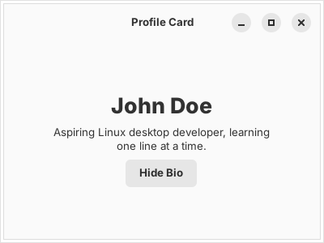
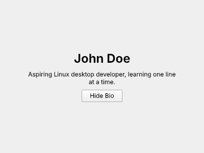
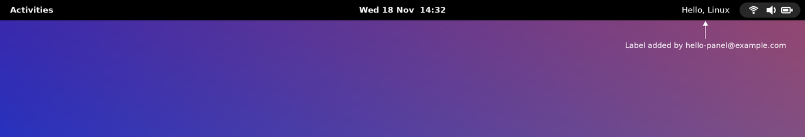
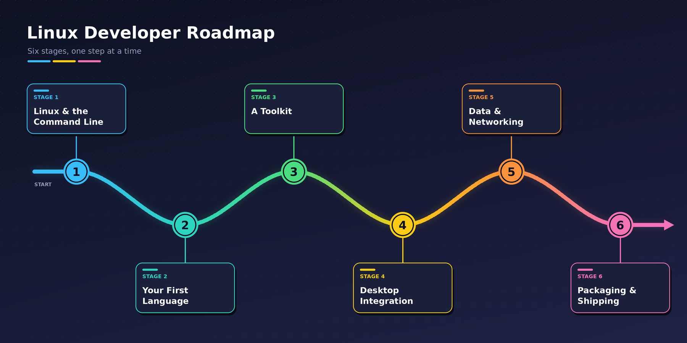

If you've read the [Desktop App Developer post](https://dynamicbytes.blog/how-to-become-a-desktop-app-developer-2026/) and the quiz pointed you here - or you already knew Linux was your lane before you got anywhere near a quiz - this is the full, deep breakdown. Everything shared across desktop platforms was already covered there, and the [Windows post](https://dynamicbytes.blog/how-to-become-a-windows-developer-2026/) and [macOS post](https://dynamicbytes.blog/how-to-become-a-macos-developer-2026/) cover the other two big desktop platforms in the same depth. This post is entirely about what's specific to Linux.

First, a note on the title. The term "Linux developer" can mean many different jobs: Kernel work, systems administration, embedded software, cloud infrastructure. This post is about none of those. It's about the **desktop layer** - the apps people click on, the extensions that change how their desktop behaves, the widgets on their panels, the icon packs and themes that make it look the way they like, and everything that sits between the user and the operating system. All of it counts, and all of it is open to you.

**Another note:** This post is about native Linux development. If what you actually had in mind is one codebase that runs on Windows, macOS, and Linux using web technologies like Electron or Tauri, that's cross-platform desktop development, and it gets its own dedicated [post](https://dynamicbytes.blog/coming-soon/) on this blog.

**One more thing:** Unlike the Windows and macOS posts, you need Linux itself before you can build for it. If you haven't got a machine running it yet, there's a tip for that below, and the [Windows to Linux guide](https://dynamicbytes.blog/how-to-switch-os-from-windows-to-linux-in-2026/) covers the full setup.

Without further ado, let's get right into it.

---

## What Is Linux Desktop Development?

Here's the picture to hold on to. On Windows, you're a guest in a building owned by Microsoft. On macOS, it's a building owned by Apple. **Linux is a whole neighbourhood.** The land underneath (the kernel) is shared, and so are the roads (standards for how programs talk to each other, like Wayland and D-Bus). But each estate on top of that land - GNOME, KDE Plasma, COSMIC, and others - is run by a different landlord with its own house rules, its own architecture, and its own idea of what a good home looks like.

That's what makes Linux development different. There's no single owner telling you which framework to use, and every part of the picture has more than one name:

**The Linux kernel** is the core of the system, and **a distribution (distro)** is a complete operating system built around it, such as Ubuntu or Fedora. If that's new, the [Windows to Linux post](https://dynamicbytes.blog/how-to-switch-os-from-windows-to-linux-in-2026/) explains both properly.

**A desktop environment** is the estate: GNOME, KDE Plasma, COSMIC, Cinnamon, XFCE and others. It provides the panel, the windows, the settings, and the look and feel.

**A toolkit** is what you build your app's interface with. The two big ones are **GTK** (GNOME's toolkit) and **Qt** (KDE's), and they get their own section below.

**Wayland** is the modern system that draws windows on the screen and routes keyboard and mouse input. It has replaced the older X11, and that matters more than it sounds. It gets its own section too.

**Flatpak, Snap, and AppImage** are ways to package an app so it runs across distros. They get covered in the distribution section.

---

## Why Linux Matters Going Into 2027

**Here's the honest numbers problem:** Nobody agrees on how big the Linux desktop is. StatCounter's worldwide desktop figure for Linux was around 3% in spring 2026, 4.36% in June, and reportedly above 7% by late summer - a swing large enough that you should treat any single figure with suspicion, since StatCounter measures web traffic rather than installed machines. Steam's hardware survey, which only counts gamers, swung from about 2% in February to a record 5.33% in March, then settled back to around 4% by May, helped by SteamOS. 

**The honest summary:** Linux is a small slice of desktops by count, growing, and much larger than that among developers and enthusiasts.

**Who actually uses it?** 
Developers, students, privacy-minded users, gamers on SteamOS and Linux handhelds, researchers, and organisations that standardise on it. The people who run Linux on the desktop do so by choice, and they tend to care about how their software works. Windows 10 reached end of support in October 2025, and that nudged more people toward looking at alternatives, though it's hard to measure exactly how many ended up on Linux.

**The honest costs:**

- **Fragmentation:** Two major toolkits, several desktop environments, and several packaging formats mean more decisions and more testing than on Windows or macOS.
- **Monetisation is harder:** The culture leans toward free and open-source software, and paid-app infrastructure is far less developed than Apple's or Microsoft's stores.
- **The market is smaller:** Compared to Windows, a Linux-only app has a smaller potential audience.

**The verdict:** Linux desktop development is a strong choice if you care about open source, enjoy tinkering at every layer of the system, and want to build things for people who notice the details. It's a weaker choice if your primary goal is a large paying consumer audience. And it's one of the best ways to build skills that transfer, since so much of the wider software world runs on Linux.

---

## What You Can Build

You can contribute to the Linux desktop in more ways than any other platform in this series. Here's the map.

| What you build             | What it's made with                             | Honest notes                                                                                                                                                                                                                                            |
| -------------------------- | ----------------------------------------------- | ------------------------------------------------------------------------------------------------------------------------------------------------------------------------------------------------------------------------------------------------------- |
| **Apps**                   | GTK 4 and libadwaita, or Qt 6                   | The main route, and the one most of this post covers.                                                                                                                                                                                                   |
| **GNOME Shell extensions** | JavaScript, via GJS                             | Reviewed before they appear on <a href="https://extensions.gnome.org" target="_blank" rel="noopener noreferrer">extensions.gnome.org</a>. They also need updating regularly - GNOME publishes porting guides for each Shell release through version 51. |
| **Plasma widgets**         | QML for the interface, JavaScript for the logic | Shared through the KDE Store. Plasma 6 required existing widgets to be ported.                                                                                                                                                                          |
| **COSMIC applets**         | Rust, with the iced toolkit and libcosmic       | A smaller ecosystem, but a real third one. System76's COSMIC desktop reached its first stable release in December 2025.                                                                                                                                 |
| **Themes and icon packs**  | CSS, SVG, and QML depending on the desktop      | Detailed below.                                                                                                                                                                                                                                         |

Themes and icon packs deserve a closer look, because they're the gentlest way in. An icon theme is a folder of SVG or PNG icons plus a small `index.theme` file, following a specification shared across desktops, and the KDE Store lists well over a thousand of them. 

For Plasma, KDE's own quickstart tells you to copy an existing Plasma Style and edit it, and says that depending on your skill with the tools, a good-looking one can be made in under an hour. You can share your work on the KDE Store or on <a href="https://gnome-look.org" target="_blank" rel="noopener noreferrer">gnome-look.org</a>. Two limits are worth knowing before you begin. First, libadwaita apps are deliberately not themable, and forcing a theme onto them isn't supported, so GNOME theming has real boundaries. Second, a GNOME Shell theme is a separate setting that needs the User Themes extension, and GTK apps don't follow a Plasma global theme, so a theme rarely looks consistent everywhere. Treat theming as a way into the community and your portfolio, not as a career route on its own.

**And a pattern worth noticing:** Much of the extension, widget, and theme world is built from JavaScript, QML, CSS, and SVG. If you came here from the [front-end post](https://dynamicbytes.blog/what-is-frontend-development-2026/), those skills transfer almost directly, which makes extensions and widgets the lowest barrier to entry on the whole desktop.

---

## GTK or Qt: The Honest Breakdown

Two toolkits, two big estates, and both are very much alive. We'll present them equally, because neither is the correct answer for everyone.

### GTK

GTK is the toolkit that GNOME is built on. In 2026 that means **GTK 4 with libadwaita**, a library on top of GTK that provides GNOME's modern look, adaptive layouts, and the widgets that make an app feel at home there. GTK is licensed under the LGPL, and you can write against it from several languages: C natively, plus Python, Rust, JavaScript, and others.

**What it's good at:** It gives you apps that look and feel native on GNOME, which includes Ubuntu's default desktop, and it's the foundation of much of the GNOME ecosystem. If you want your app to feel like part of GNOME, GTK 4 with libadwaita is the route.

**The honest trade-offs:** libadwaita ties you to GNOME's design language, and the result looks less at home on other desktops such as KDE Plasma. GNOME also has strong opinions about how apps should look and behave, and your app is expected to follow them.

### Qt

Qt is the toolkit that KDE is built on, and it's far from only a Linux toolkit: it also runs on Windows, macOS, and other platforms, so code you write for Qt isn't locked to one operating system. Its native language is **C++**, and its interface language **QML** (Qt Quick) lets you describe screens declaratively, with JavaScript for the logic. Qt is available under a commercial licence, the GPL, or the LGPL, and which one you pick matters if you plan to distribute closed-source software.

**What it's good at:** the same codebase can reach beyond Linux, it's a mature framework with a huge set of features, and it's what KDE apps are built with. If you think you may want Windows or macOS builds later, or you want to build for KDE, Qt is the natural route.

**The honest trade-offs:** the licensing options need understanding up front, it's a larger framework than GTK, and C++ is a steeper starting language than the Python you can use with GTK. (There are Python bindings for Qt too, with licensing differences covered below.)

### A Third Option

COSMIC, System76's desktop, builds its apps in **Rust** with the iced toolkit and a library called libcosmic. It's a smaller ecosystem than GTK or Qt, but it's real, and it's worth knowing about if Rust appeals to you.

### The Verdict

**Don't pick a winner - pick by audience and ambition.** GTK 4 with libadwaita is the better fit when you're building for GNOME users and want an app that feels native there. Qt is the better fit when you want KDE users, or a codebase that could travel to other platforms. Both are mature, well documented, and capable of excellent apps. Because the two share the same concepts - widgets, layouts, signals and events, the application lifecycle - learning one makes the other far easier, so choosing now doesn't lock you in.

---

## Which One Should You Learn?

The tree below is the short version of everything above, shaped as a few questions. Follow the branch that matches what you want to build, and click a leaf to jump to the matching section.

<div class="dtree-wrapper">
  <ul class="dtree">
    <li>
      <span class="dtree-node dtree-node-plain">Building something new, or joining an existing project?</span>
      <ul>
        <li>
          <span class="dtree-node dtree-node-leaf">
            Existing project
            <span class="dtree-sub">Learn whatever toolkit it's built on - GTK or Qt</span>
          </span>
        </li>
        <li>
          <span class="dtree-node dtree-node-plain">New: an app, or a change to someone's desktop?</span>
          <ul>
            <li>
              <span class="dtree-node dtree-node-plain">An extension, widget, or theme</span>
              <ul>
                <li>
                  <a href="#beyond-apps-your-first-gnome-shell-extension" class="dtree-node dtree-node-leaf">
                    For GNOME users
                    <span class="dtree-sub">GNOME Shell extension (JavaScript)</span>
                  </a>
                </li>
                <li>
                  <a href="#what-you-can-build" class="dtree-node dtree-node-leaf">
                    For KDE users
                    <span class="dtree-sub">Plasma widget (QML) or Plasma Style</span>
                  </a>
                </li>
              </ul>
            </li>
            <li>
              <span class="dtree-node dtree-node-plain">An app: does it need to run on Windows or macOS too?</span>
              <ul>
                <li>
                  <a href="/coming-soon/" class="dtree-node dtree-node-leaf">
                    Yes
                    <span class="dtree-sub">Cross-Platform Desktop</span>
                    <span class="dtree-badge">Coming Soon</span>
                  </a>
                </li>
                <li>
                  <span class="dtree-node dtree-node-plain">Linux only: who is it for?</span>
                  <ul>
                    <li>
                      <a href="#gtk" class="dtree-node dtree-node-leaf">
                        GNOME users, a native feel there
                        <span class="dtree-sub">GTK 4 + libadwaita</span>
                      </a>
                    </li>
                    <li>
                      <a href="#qt" class="dtree-node dtree-node-leaf">
                        KDE users, or a codebase that may travel later
                        <span class="dtree-sub">Qt 6</span>
                      </a>
                    </li>
                  </ul>
                </li>
              </ul>
            </li>
          </ul>
        </li>
      </ul>
    </li>
  </ul>
</div>

<p class="dtree-caption">Click any leaf to jump to that section - or, for the cross-platform branch, to the guide that's coming next.</p>

<style>
.dtree-wrapper {
  margin: 2rem 0 0.5rem;
  padding: 1.5rem 1rem;
  border: 1px solid var(--border);
  border-radius: 8px;
  background: var(--surface);
  overflow-x: auto;
}

.dtree, .dtree ul {
  position: relative;
  padding-top: 1.75rem;
  display: flex;
  justify-content: center;
  margin: 0;
}

.dtree {
  padding-top: 0;
}

.dtree li {
  list-style-type: none;
  position: relative;
  padding: 1.75rem 0.75rem 0;
  text-align: center;
}

.dtree > li {
  padding-top: 0;
}

.dtree li::before,
.dtree li::after {
  content: '';
  position: absolute;
  top: 0;
  right: 50%;
  width: 50%;
  height: 1.75rem;
  border-top: 2px solid var(--border);
}

.dtree li::after {
  right: auto;
  left: 50%;
  border-left: 2px solid var(--border);
}

.dtree li:only-child::before,
.dtree li:only-child::after {
  display: none;
}

.dtree li:only-child {
  padding-top: 0;
}

.dtree li:first-child::before {
  border: none;
}

.dtree li:last-child::after {
  border-top: none;
}

.dtree li:first-child::after {
  border-radius: 0;
}

.dtree li:last-child::before {
  border-radius: 0;
}

.dtree ul::before {
  content: '';
  position: absolute;
  top: 0;
  left: 50%;
  border-left: 2px solid var(--border);
  width: 0;
  height: 1.75rem;
}

.dtree-node {
  display: inline-flex;
  flex-direction: column;
  align-items: center;
  gap: 0.35rem;
  background: var(--bg);
  border: 1px solid var(--border);
  border-radius: 6px;
  padding: 0.6rem 0.9rem;
  font-family: 'Inter', sans-serif;
  font-size: 0.88rem;
  font-weight: 600;
  color: var(--text);
  text-decoration: none;
  white-space: nowrap;
  transition: border-color 0.2s ease, transform 0.15s ease;
}

a.dtree-node:hover {
  border-color: var(--accent);
  transform: translateY(-2px);
}

.dtree-node-plain {
  color: var(--accent);
  cursor: default;
  font-size: 1.05rem;
}

.dtree-node-leaf {
  font-size: 0.85rem;
  font-weight: 500;
  color: var(--text-muted);
}

.dtree-badge {
  font-size: 0.62rem;
  font-weight: 600;
  text-transform: uppercase;
  letter-spacing: 0.04em;
  color: var(--text-muted);
  border: 1px solid var(--border);
  border-radius: 4px;
  padding: 0.1rem 0.4rem;
}

.dtree-badge-live {
  color: var(--accent);
  border-color: var(--accent);
}

.dtree-caption {
  text-align: center;
  font-size: 0.85rem;
  color: var(--text-muted);
  margin-top: 0.5rem;
}

/* Windows post additions: allow question/answer text to wrap, add a sub-label */
.dtree-node {
  white-space: normal;
  max-width: 11rem;
}

.dtree-node-plain {
  font-size: 0.9rem;
}

.dtree-sub {
  font-size: 0.75rem;
  font-weight: 600;
  color: var(--accent);
}
</style>

---

## Pick Your Language

Windows has C# and macOS has Swift, but Linux doesn't have one official language. That's a strength and a source of confusion, so we'll lay out the real differences instead of telling you which to follow.

### First, Understand the Spectrum

Languages sit on a spectrum from **high-level** to **systems-level**.

**High-level languages** - such as Python, JavaScript - handle a lot for you. They manage memory automatically, the code reads close to plain English, and you get a working result quickly. The price is speed and some control.

**Systems-level languages** - such as C, C++, Rust - sit much closer to the machine. You decide more about how memory is used, and the code compiles to fast native programs. The price is a steeper learning curve and more rules to follow.

Think of it as an electric screwdriver against a precision lathe. The screwdriver gets you building almost immediately. The lathe gives you exact shape and speed, but you take on the measuring.

**One misconception to clear up:** It's tempting to think of Rust as the language for "kernel-level control", because Rust really has been accepted into the Linux kernel itself. But a Rust desktop app is still an ordinary program running in user space, like any other app. What Rust gives you is speed and memory safety without a garbage collector. C and C++ give you similar low-level control, in different ways.

### The Comparison Table

|                   | **JavaScript / QML**                                                            | **Python**                                                 | **C++**                                                 | **Rust**                                                            |
| ----------------- | ------------------------------------------------------------------------------- | ---------------------------------------------------------- | ------------------------------------------------------- | ------------------------------------------------------------------- |
| **Level**         | High-level, interpreted                                                         | High-level, interpreted                                    | Systems-level, compiled                                 | Systems-level, compiled, memory-safe                                |
| **Native to**     | GNOME extensions and GJS apps; Plasma widgets                                   | GTK apps through PyGObject; Qt apps through PySide6        | Qt itself                                               | GTK apps through gtk-rs; the COSMIC desktop                         |
| **Its edge**      | The route for shell extensions and widgets; web skills transfer directly        | Easiest to read and learn; fastest path to a working app   | Qt's own language; full control with a mature toolkit   | Speed and memory safety without a garbage collector; modern tooling |
| **The trade-off** | Narrower for large standalone apps; extensions need updating each GNOME release | Slower at runtime; needs its runtime packaged with the app | Steepest to learn; manual memory management brings risk | Steep learning curve; smaller GUI ecosystem                         |
| **A good fit if** | You know web development, or want to build extensions and widgets               | Python is already your language, or this is your first     | You want Qt in depth, or industry-style native work     | You want performance and safety and accept a steep mountain climb   |

### Which Route Is Yours?

<div class="route-wrapper">
	<div class="route-item">
		<button class="route-question" aria-expanded="false">
			1. Already fluent in Python?
			<span class="route-icon">+</span>
		</button>
		<div class="route-answer">
			<p>Stay with it. It covers both GTK apps (PyGObject) and Qt apps (PySide6), so there's no reason to learn another language before you've built something. Dig deeper into the language you know rather than starting over.</p>
		</div>
	</div>
	
	<div class="route-item">
		<button class="route-question" aria-expanded="false">
			2. A beginner to programming?
			<span class="route-icon">+</span>
		</button>
		<div class="route-answer">
			<p>Python or JavaScript will get you to a working result fastest. Python is a high-level language, valued for being easy to read and understand, and it's a fine first language to build a desktop app in.</p>
		</div>
	</div>
	
	<div class="route-item">
		<button class="route-question" aria-expanded="false">
			3. Know what you want to build?
			<span class="route-icon">+</span>
		</button>
		<div class="route-answer">
			<p>Let that choose. Extensions and widgets point to JavaScript and QML. A performance-sensitive or heavy app points to C++ or Rust.</p>
		</div>
	</div>
	
	<div class="route-item">
		<button class="route-question" aria-expanded="false">
			4. Curious about Rust?
			<span class="route-icon">+</span>
		</button>
		<div class="route-answer">
			<p>It's a rewarding language, but a demanding one for a first language. Many people come to it after building something in Python, and then know exactly what they're gaining.</p>
		</div>
	</div>
	
	<div class="route-item">
		<button class="route-question" aria-expanded="false">
			5. Not sure?
			<span class="route-icon">+</span>
		</button>
		<div class="route-answer">
			<p>Start with Python. Nothing you learn is wasted: the toolkit concepts carry across every language, and you can move to a systems language later with a real reason to.</p>
		</div>
	</div>
	
</div>

<style> 
	.route-wrapper { 
		margin: 2rem 0; 
		border: 1px solid var(--border); 
		border-radius: 8px; 
		overflow: hidden; 
	} 
	
	.route-item { 
		border-bottom: 1px solid var(--border); 
	} 
	
	.route-item:last-child { 
		border-bottom: none; 
	} 
	
	.route-question {
		 width: 100%; 
		 background: var(--surface); 
		 border: none; 
		 padding: 1rem 1.25rem; 
		 text-align: left; 
		 cursor: pointer; 
		 display: flex; 
		 justify-content: space-between; 
		 align-items: center; 
		 font-size: 1rem; 
		 font-family: inherit; 
		 color: var(--text); 
		 transition: background 0.2s ease; 
	} 
	
	.route-question:hover { 
		background: var(--border);
	}
	 
	.route-icon { 
		font-size: 1.25rem; 
		color: var(--accent); 
		transition: transform 0.25s ease; 
		flex-shrink: 0; 
		margin-left: 1rem;
	} 
	
	.route-question[aria-expanded="true"] .route-icon {
		transform: rotate(45deg); 
	} 
	
	.route-answer { 
		display: none; 
		padding: 1rem 1.25rem 1.25rem; 
		background: var(--bg); 
		color: var(--text-muted); 
		line-height: 1.7; 
		font-size: 0.97rem; 
	} 
	
	.route-answer p { 
		margin: 0; 
	} 
</style> 

<script> 
	document.querySelectorAll('.route-question').forEach(function(btn) {
		btn.addEventListener('click', function() { 
			var expanded = this.getAttribute('aria-expanded') === 'true'; 
			var answer = this.nextElementSibling; 
			
			document.querySelectorAll('.route-question').forEach(function(other) {
				other.setAttribute('aria-expanded', 'false');
				other.nextElementSibling.style.display = 'none';
			}); 
			
			if (!expanded) { 
				this.setAttribute('aria-expanded', 'true');
				answer.style.display = 'block'; 
			} 
		}); 
	}); 
</script>

**A licensing note for the Python and Qt route:** PyQt6 is licensed under the GPL or a paid commercial licence, while PySide6 is under the LGPL. If you plan to distribute closed-source software without a commercial licence, that difference matters, so check before you commit.

---

## Wayland and What It Means for You

Wayland has replaced the older X11 as the system that draws windows and routes input, and in 2026 the switch became close to complete. GNOME 50 (March 2026) removed X11 sessions entirely. KDE Plasma 6.8, released on 14 October 2026, removed its X11 session too, and KDE had already reported that over 95% of Plasma 6.6 users were on Wayland. Older X11 apps still run through a compatibility layer called XWayland, but the desktop itself is now Wayland.

**What that means for you as a developer:**

- **Build and test on Wayland:** It's the default, and it's where your users will be.
- **Expect it to be stricter:** Wayland is deliberately tighter than X11 about what one app can see and do to another. Things that were once simple, like capturing the screen or setting a window's exact position, typically go through controlled routes called portals (more on those below).
- **Old tutorials may mislead:** Anything written for X11 may rely on behaviour that no longer exists. Check the date and the target before you follow it.

---

## Building Your First Screen

Enough theory - let's build the same simple screen two different ways, so the difference between GTK and Qt is something you feel, not just read about.

By the end of this section you'll have a small profile card - a name, a bio, and a button that toggles the bio's visibility - in both toolkits. If you've read the [front-end post](https://dynamicbytes.blog/what-is-frontend-development-2026/), the [Android post](https://dynamicbytes.blog/how-to-become-an-android-developer-2026/), the [Windows post](https://dynamicbytes.blog/how-to-become-a-windows-developer-2026/), or the [macOS post](https://dynamicbytes.blog/how-to-become-a-macos-developer-2026/), you'll recognise the exact same card; same result, completely different toolkit. We're using Python for both, so the only thing that changes is the toolkit.

> **No Linux machine yet? Here's how to start anyway.**
>
> You need Linux to follow this post, but you don't need to commit to it straight away:
>
> - **Try it from a USB stick:** Ubuntu's installer can boot a live session that runs without touching your disk. The [Windows to Linux guide](https://dynamicbytes.blog/how-to-switch-os-from-windows-to-linux-in-2026/) shows you how to create the USB, and whether to dual boot or wipe.
> - **Use a virtual machine:** It runs Linux inside a window on your current system. It's slower, but safe and reversible, and fine for learning.
> - **Windows 11 users can try WSL:** WSL (Windows Subsystem for Linux) runs Linux inside Windows. It's good for learning the command line and can run some graphical apps, but it isn't the best place to test how your app behaves on a real desktop.
> - **Learn the terminal first:** Everything below uses it, so the [Bash scripting post](https://dynamicbytes.blog/bash-scripting-for-beginners-in-2026-automate-your-linux-workflow/) is worth reading before you start.

**Setup for the GTK version (Ubuntu or Debian):**

```bash
sudo apt install python3-gi gir1.2-gtk-4.0 gir1.2-adw-1
```

Other distros use different package names, so search for "PyGObject", "GTK 4" and "libadwaita" in your package manager.

**Setup for the Qt version:**

```bash
python3 -m venv .venv
source .venv/bin/activate
pip install PySide6
```

### The GTK Way

`profile_card.py`:

```python
import sys
import gi

gi.require_version("Gtk", "4.0")
gi.require_version("Adw", "1")
from gi.repository import Adw, Gtk


class ProfileCardWindow(Adw.ApplicationWindow):
    def __init__(self, **kwargs):
        super().__init__(**kwargs)
        self.set_title("Profile Card")
        self.set_default_size(400, 300)

        # Vertical box that holds the name, the bio, and the button
        box = Gtk.Box(orientation=Gtk.Orientation.VERTICAL, spacing=8)
        box.set_halign(Gtk.Align.CENTER)
        box.set_valign(Gtk.Align.CENTER)

        name = Gtk.Label(label="John Doe")
        name.add_css_class("title-1")

        self.bio = Gtk.Label(
            label="Aspiring Linux desktop developer, learning one line at a time."
        )
        self.bio.set_wrap(True)
        self.bio.set_max_width_chars(30)
        self.bio.set_justify(Gtk.Justification.CENTER)

        self.button = Gtk.Button(label="Hide Bio")
        self.button.set_halign(Gtk.Align.CENTER)
        self.button.connect("clicked", self.on_toggle)

        box.append(name)
        box.append(self.bio)
        box.append(self.button)

        # A header bar gives the window its title and close button
        toolbar = Adw.ToolbarView()
        toolbar.add_top_bar(Adw.HeaderBar())
        toolbar.set_content(box)
        self.set_content(toolbar)

    def on_toggle(self, _button):
        # Flip the bio's visibility, then update the button label to match
        show = not self.bio.get_visible()
        self.bio.set_visible(show)
        self.button.set_label("Hide Bio" if show else "Show Bio")


class ProfileCardApp(Adw.Application):
    def __init__(self):
        super().__init__(application_id="com.example.ProfileCard")
        self.connect("activate", self.on_activate)

    def on_activate(self, app):
        ProfileCardWindow(application=app).present()


app = ProfileCardApp()
sys.exit(app.run(sys.argv))
```

Run it with `python3 profile_card.py`.



> **Notice the pattern:**
> This is the imperative style. You create each widget, set its properties, connect the button to a function, and when the button is clicked, your function changes the bio and the label by hand. You tell GTK each step.

### The Qt Way

`main.py`:

```python
import sys
from pathlib import Path

from PySide6.QtGui import QGuiApplication
from PySide6.QtQml import QQmlApplicationEngine

app = QGuiApplication(sys.argv)
engine = QQmlApplicationEngine()

# Load the interface, which is described in a separate QML file
engine.load(str(Path(__file__).parent / "Main.qml"))

if not engine.rootObjects():
    sys.exit(-1)

sys.exit(app.exec())
```

`Main.qml`:

```qml
import QtQuick
import QtQuick.Controls
import QtQuick.Layouts

ApplicationWindow {
    visible: true
    width: 400
    height: 300
    title: "Profile Card"

    // The single piece of state the whole screen depends on
    property bool showBio: true

    ColumnLayout {
        anchors.centerIn: parent
        spacing: 8

        Label {
            text: "John Doe"
            font.pixelSize: 24
            font.bold: true
            Layout.alignment: Qt.AlignHCenter
        }

        Label {
            visible: showBio
            text: "Aspiring Linux desktop developer, learning one line at a time."
            wrapMode: Text.WordWrap
            horizontalAlignment: Text.AlignHCenter
            Layout.preferredWidth: 300
            Layout.alignment: Qt.AlignHCenter
        }

        Button {
            text: showBio ? "Hide Bio" : "Show Bio"
            Layout.alignment: Qt.AlignHCenter
            onClicked: showBio = !showBio
        }
    }
}
```

Put both files in the same folder and run `python3 main.py`.



> **Notice the pattern:**
> This is the declarative style. There's no code that says "hide the bio." There's a `showBio` value, and the screen is described in terms of it. When the button flips the value, everything that depends on it updates by itself. You describe the result; the framework works out the steps.

Same result. Now look at what actually changed, because those differences are the whole "two toolkits" idea in miniature:

| What | GTK 4 + libadwaita | Qt 6 (Qt Quick) |
| ---- | ------------------ | --------------- |
| **Style** | Imperative - create widgets and change them yourself | Declarative - describe the screen for the current state |
| **Where the UI lives** | In Python code | In a separate QML file |
| **Tracking state** | You update the label and the button text by hand | A `showBio` property; the screen updates automatically |
| **Hiding the bio** | `self.bio.set_visible(show)` | `visible: showBio` |
| **Layout** | `Gtk.Box` with alignment settings | `ColumnLayout` with `Layout.alignment` |
| **Window chrome** | `Adw.HeaderBar` inside `Adw.ToolbarView` | Provided by the `ApplicationWindow` |

If you've worked through React on the front-end or Jetpack Compose in the Android post, the Qt version's "UI as a function of state" will feel familiar, and the GTK version will feel like the more traditional, hands-on way of doing the same job. Both are valid, and which feels natural to you is a useful signal.

---

## Beyond Apps: Your First GNOME Shell Extension

Apps aren't the only thing you can build. Here's a very small GNOME Shell extension that puts a label in the top panel, and it shows how different extension work feels. You write JavaScript, and you're modifying the desktop itself.

**A warning first:** The GNOME Shell extension API changes between releases, and that's exactly why GNOME publishes porting guides. Check your version with `gnome-shell --version`, and if anything below doesn't work on yours, the official guide at [gjs.guide](https://gjs.guide/extensions/) is the reference to follow.

Create a folder for the extension:

```bash
mkdir -p ~/.local/share/gnome-shell/extensions/hello-panel@example.com
cd ~/.local/share/gnome-shell/extensions/hello-panel@example.com
```

`metadata.json` (set `shell-version` to your GNOME major version):

```json
{
  "uuid": "hello-panel@example.com",
  "name": "Hello Panel",
  "description": "Adds a small label to the top panel.",
  "shell-version": ["50"]
}
```

`extension.js`:

```javascript
import St from 'gi://St';
import Clutter from 'gi://Clutter';
import * as Main from 'resource:///org/gnome/shell/ui/main.js';
import * as PanelMenu from 'resource:///org/gnome/shell/ui/panelMenu.js';
import {Extension} from 'resource:///org/gnome/shell/extensions/extension.js';

export default class HelloPanelExtension extends Extension {
    enable() {
        // A button that lives in the top panel's status area
        this._indicator = new PanelMenu.Button(0.0, this.metadata.name, false);

        const label = new St.Label({
            text: 'Hello, Linux',
            y_align: Clutter.ActorAlign.CENTER,
        });
        this._indicator.add_child(label);

        Main.panel.addToStatusArea(this.uuid, this._indicator);
    }

    disable() {
        // Always clean up everything you created in enable()
        this._indicator?.destroy();
        this._indicator = null;
    }
}
```

Then enable it:

```bash
gnome-extensions enable hello-panel@example.com
```

On Wayland, GNOME needs to be restarted before it notices a brand-new extension, so log out and back in. After that, "Hello, Linux" should appear in the top panel. If it doesn't, read the Shell's log in a terminal with `journalctl -f -o cat /usr/bin/gnome-shell` - that's where errors appear.



**What you just learnt:**

- **An extension has just two required files:** `metadata.json` describes it, and `extension.js` has an `enable()` and a `disable()` function.
- **`disable()` matters:** An extension must undo everything it did in `enable()`, or it leaks into the user's session. It's also one of the things reviewers check.
- Extensions published on <a href="https://extensions.gnome.org" target="_blank" rel="noopener noreferrer">extensions.gnome.org</a> are reviewed first, so plan for that when you want to share one.
- And because the Shell's internals change, a published extension needs updating when new GNOME versions arrive. That maintenance is the real cost of extension work.

---

## Linux Platform Features

Like the Windows and macOS posts, here are the amenities - the things a native Linux app gets that a website doesn't. In the neighbourhood picture, these are the shared utilities every estate connects to.

**D-Bus is the postal service:** Programs on a Linux desktop talk to each other and to the system over D-Bus, a message bus. Notifications, media-player controls, and settings changes all travel across it. You'll meet it as soon as your app needs to talk to anything outside itself, and most toolkits wrap it so you rarely handle raw messages.

**Portals are the reception desk:** Wayland, and sandboxed apps from Flatpak, are stricter about what an app may touch. Instead of reaching directly for a file, the camera, or a screenshot, your app asks through a portal, the user approves it in a system dialog, and the desktop does the work on your behalf. The toolkits use portals for you for common tasks like the file chooser, but you need to know why they exist.

**`.desktop` files are your nameplate:** A small text file describes your app to the desktop: its name, its icon, how to launch it, and which file types it can open. It's what puts your app in the launcher and makes double-clicking a file open it in your app.

**Notifications:** Go through the desktop's own notification system, so they match the user's settings and look native.

**Tray icons are the stumbling block:** Many utilities on other platforms live in the system tray, but GNOME doesn't show legacy tray icons by default, so users often rely on an extension to see them. KDE Plasma supports them. If your app is a background utility, decide how it behaves on desktops without a tray, and don't make a tray icon the only way to reach it.

**User services run in the background:** Linux apps that need to start at login or keep running without a window are often managed as systemd user services. It's the standard way to run something quietly all day.

**Two more are worth a one-line mention:** The **GNOME and KDE human interface guidelines** (each desktop publishes design rules for how apps should look and behave, and reading them is close to required), and **freedesktop standards** (shared specifications, such as the icon theme and desktop entry specs, that make apps work across desktops).

---

## Distribution: Flatpak, Snap, AppImage, and Distro Packages

Writing the app is half the job. Getting it onto someone else's machine is the other half, and on Linux you have more routes than anywhere else, because there's no single store. Think of it as choosing between several markets, each with its own stall rules.

### The Routes

- **Flatpak and Flathub:** Flatpak packages an app together with the libraries it needs, runs it in a sandbox, and uses portals for access to files and devices. Flathub is the main place to publish and find Flatpak apps, and it works across distros. This is the most widely adopted cross-distro route today.
- **Snap:** Canonical's own packaging format, with its own store. It's installed by default on Ubuntu and works across distros, but it's tied more closely to one company's ecosystem than Flatpak is.
- **AppImage:** A single file that you download and run. It needs no store and no installation, which makes it simple. It doesn't sandbox by default, and updates are up to you.
- **Distro packages (`.deb` and `.rpm`):** Packages built for a specific distro family, installed through its package manager. They integrate best with one system but only reach users of that family.

Extensions, widgets, and themes have their own distribution points: <a href="https://extensions.gnome.org" target="_blank" rel="noopener noreferrer">extensions.gnome.org</a> for GNOME Shell extensions, and the KDE Store for Plasma widgets and styles.

**Takeaway Note on money:** Flathub has been working on developer verification and on ways to take donations and payments, but we couldn't confirm exactly what's live today, so check Flathub's own documentation before you plan around it. Overall, selling software on Linux is far less established than on Apple's or Microsoft's stores, and many projects rely on donations, sponsorships, or services instead. None of the routes above involves a paid developer membership like Apple's $99 (check each store's current terms), but each has its own review rules.

### The Verdict

**Start with Flatpak and Flathub for apps:** It reaches the widest range of distros, matches where the desktop is heading with sandboxing and portals, and teaches you the right habits from the beginning. Learn AppImage as a simple fallback, and know distro packages exist because some employers and projects will require them. Don't build for one distro and hope: target a runtime, and you reach everyone.

---

## Tools You'll Work With

- **GNOME Builder** - GNOME's own IDE, built for GTK and GNOME apps, with Flatpak building integrated.
- **Qt Creator** - The IDE for Qt and QML, with a visual designer for Qt Quick interfaces.
- **VS Code** - The editor most people already use. It works well for Python, JavaScript, and Rust.
- **Meson and CMake** - The build systems GNOME apps (Meson) and Qt projects (CMake) typically use. You can start without them and learn them as projects grow.
- **GTK Inspector** - A built-in tool for inspecting a running GTK app's widgets and styling. A very useful debugging companion.
- **Inkscape** - The open-source vector editor, ideal for making icons and theme artwork in SVG.
- **Git & GitHub** - Version control, non-negotiable, same as everywhere else on this blog.
- **The terminal** - Linux developers live in it, which is why the [Bash scripting post](https://dynamicbytes.blog/bash-scripting-for-beginners-in-2026-automate-your-linux-workflow/) is worth reading early.

### AI-Assisted Linux Desktop Development

If your instinct is to roll your eyes at yet another AI layer bolted onto your tools, that's a fair instinct in 2026, and this isn't going to try to talk you out of it with hype. One thing is different from the Windows and macOS posts: Linux has no single vendor shipping an official AI toolkit for its desktop. You'd use general-purpose coding assistants and agents, and that makes the traps specific to this platform.

**The traps:**

- **Outdated toolkits:** Assistants often suggest GTK 3 or Qt 5 patterns, or code written for X11, none of which fits a modern GTK 4, Qt 6, Wayland setup. If you can't tell which version a suggestion targets, you can't tell whether it will work.
- **Extension APIs that move:** GNOME Shell's extension API changes between releases, and an assistant trained on older code may produce an extension that fails on your version. Check against the official guides.
- **Mixing GTK and libadwaita** or just straight up confusing GNOME and KDE conventions. A suggestion can be valid for one desktop and wrong for another.

**How to use it well:**

- **Verify against the official documentation:** <a href="https://gjs.guide" target="_blank" rel="noopener noreferrer">gjs.guide</a> for extensions, <a href="https://docs.gtk.org" target="_blank" rel="noopener noreferrer">docs.gtk.org</a> for GTK, <a href="https://doc.qt.io" target="_blank" rel="noopener noreferrer">doc.qt.io</a> for Qt, and <a href="https://develop.kde.org" target="_blank" rel="noopener noreferrer">develop.kde.org</a> for KDE. Make the assistant cite the version it's targeting.
- **Let it write boilerplate, not understanding:** If you can't explain what a piece of suggested code does, don't keep it.
- **Treat generated code as a first draft:** Test it on the real desktop, under Wayland, before trusting it.

**The honest takeaway:** These tools are an asset and a real productivity gain when they speed you through things you already understand, and a liability when they let you skip understanding them. Learn a language and a toolkit properly first - then let the tools handle the repetitive parts.

---

## Jobs, Salaries & Demand in 2027

### The Job Market

Let's be honest: Linux desktop-specific job listings are a narrow market, and the post wouldn't be doing its job if it hid that. The work tends to come from a few places: companies and organisations built around Linux distributions and desktop environments, open-source product companies, embedded and device software where Qt interfaces are common, developer-tool and infrastructure companies that ship Linux apps, and freelance or contract work. Funding in open source often comes through sponsorship and grants, not conventional job listings.

The good news is the skills travel. Linux, a programming language, a UI toolkit, packaging, and working in the open are all valued well beyond the desktop. Many people use Linux desktop development as a way to build the portfolio and open-source track record that opens doors elsewhere.

### Salary Ranges (Approximate, 2027)

| Level     | Nigeria (NGN/year) | Global Remote (USD/year) |
| --------- | ------------------ | ------------------------ |
| Junior    | ₦1.8M - ₦4M          | $40,000 - $68,000        |
| Mid-level | ₦4M - ₦8.5M          | $68,000 - $112,000       |
| Senior    | ₦8.5M - ₦19M+        | $112,000 - $185,000+     |

> **Disclaimer:**
> These are directional figures, in line with the desktop-wide ranges from the Desktop App Developer post - we couldn't find a reliable salary dataset for Linux desktop development alone, and we'd rather say so than invent false precision. Actual pay varies significantly by employer, industry, and location. Developers who can pair Linux desktop skills with back-end, systems, or embedded skills tend to have more options at every level.

---

## The Full Roadmap

This is the full zero-to-hero roadmap to follow in order to have the skills necessary to land a role or ship your first app, extension, or widget. Follow it stage-by-stage and move to the next stage only when you've satisfied the criteria to do so.



### Stage 1 - Linux & the Command Line (2-4 weeks)

You can't build for a platform you don't live in. Install Linux, learn the terminal, understand files and permissions, and get comfortable with a package manager. The [Windows to Linux guide](https://dynamicbytes.blog/how-to-switch-os-from-windows-to-linux-in-2026/) and the [Bash scripting post](https://dynamicbytes.blog/bash-scripting-for-beginners-in-2026-automate-your-linux-workflow/) cover this stage in full. Set up Git alongside it.

**You're ready to move on when:** you can navigate a Linux system from the terminal, install and remove software, and use Git without looking things up.

### Stage 2 - Your First Language (4-8 weeks)

Pick one language using the section above and learn it properly: variables, control flow, functions, data structures, classes, errors, and files. Build small command-line programs before opening any interface. For most readers that means Python or JavaScript; for systems languages, allow longer.

**You're ready to move on when:** you can write programs of a few hundred lines in your language without constantly checking the documentation.

### Stage 3 - A Toolkit (8-10 weeks)

Learn one toolkit well: GTK 4 with libadwaita, or Qt 6 with QML. Windows and layout, widgets, signals and events, state, and the application lifecycle. Rebuild the profile card from this post, then something bigger, and then rebuild it in the other toolkit to see what carries across.

**You're ready to move on when:** you can build a multi-screen app with menus and proper layouts, and explain how data flows through it.

### Stage 4 - Desktop Integration (4-6 weeks)

The Linux-specific layer: D-Bus, portals, `.desktop` files, notifications, and how Wayland differs from X11. Read your desktop's design guidelines. If extensions or widgets are your goal, this is also where you build your first one properly, including the review rules.

**You're ready to move on when:** your app opens files from the system, sends notifications, and behaves correctly under Wayland.

### Stage 5 - Data & Networking (6-8 weeks)

Local data with SQLite, HTTP and JSON for talking to APIs, and - critically - doing slow work without freezing the interface. If you want the back-end side of this conversation explained properly, the [back-end development post](https://dynamicbytes.blog/how-to-get-into-backend-development-2026/) on this blog covers it in full.

**You're ready to move on when:** you can build an app that fetches data from a real API, stores it locally, and displays it, handling loading and error states properly.

### Stage 6 - Packaging & Shipping (4-6 weeks)

Package your app as a Flatpak and submit it to Flathub, or publish an extension on <a href="https://extensions.gnome.org" target="_blank" rel="noopener noreferrer">extensions.gnome.org</a>, or a widget on the KDE Store. Add tests, write a clear README, and respond to review feedback. Shipping through a real review process is the lesson this stage teaches.

**You're ready to move on when:** you've shipped something - even something small - that a stranger could install on their own machine without your help.

---

## Building Your Portfolio

Linux hiring, like most of software development, is portfolio-driven, and in open source your work is public by default.

- **GitHub** - A well-documented profile with real, working projects. Commit history that shows consistent progress over time is a genuine signal.
- **A published app, extension, or widget** - on Flathub, <a href="https://extensions.gnome.org" target="_blank" rel="noopener noreferrer">extensions.gnome.org</a>, or the KDE Store. Getting through a real review and having strangers install your work is a strong signal.
- **Open-source contributions** - Fixing documentation, reporting a reproducible bug, or contributing a small patch to a GNOME or KDE project you actually use. This is how many people in this world get noticed, and both projects publish guidance for newcomers.
- **A small tool for a real person** - A launcher, a note app, a system-monitor widget. "I built this and people use it" is a strong thing to say in an interview.
- **Themes and icon packs** - A well-made icon pack on the KDE Store or <a href="https://gnome-look.org" target="_blank" rel="noopener noreferrer">gnome-look.org</a> shows craft and community presence, even though it isn't a career in itself.

---

## Certifications

**Here's the honest version:** there isn't a Linux *desktop development* certification to chase. Linux certifications do exist, such as those from Red Hat, the Linux Foundation, and CompTIA, but they test system administration, not building desktop software. They're worth knowing about if the broader Linux path interests you, but they aren't what a hiring manager looks for in a desktop developer.

Unlike cybersecurity, where certifications like Security+ or OSCP carry real weight, desktop development hiring doesn't have an equivalent certification culture. A shipped app and a solid public track record do more for you in an interview than any credential would - which is exactly why the portfolio section comes before this one, not after.

---

## Common Mistakes

<div class="mistake-wrapper">
	<div class="mistake-item">
		<button class="mistake-question" aria-expanded="false">
			1. Following outdated GTK 3, Qt 5, or X11 tutorials
			<span class="mistake-icon">+</span>
		</button>
		<div class="mistake-answer">
			<p>Linux has been around for decades and the internet is full of old guides. Much of it targets GTK 3, Qt 5, or X11 behaviour that no longer matches a modern desktop. Check the toolkit version and the date of whatever you're following, and treat anything that assumes X11 as a warning sign now that GNOME and Plasma have both removed it.</p>
		</div>
	</div>
	
	<div class="mistake-item">
		<button class="mistake-question" aria-expanded="false">
			2. Only testing on your own desktop
			<span class="mistake-icon">+</span>
		</button>
		<div class="mistake-answer">
			<p>Your app will run on desktops you don't use. An app that looks perfect on GNOME can look out of place on KDE, and behaviour can differ between environments. Test on at least two desktops, always under Wayland, and use a virtual machine if you don't want to switch your daily setup.</p>
		</div>
	</div>
	
	<div class="mistake-item">
		<button class="mistake-question" aria-expanded="false">
			3. Assuming a tray icon will just work
			<span class="mistake-icon">+</span>
		</button>
		<div class="mistake-answer">
			<p>GNOME doesn't show legacy tray icons by default, so an app that can only be reached through one may seem to vanish for those users. Design your app so that every important action is reachable from its main window, and treat the tray as an optional extra.</p>
		</div>
	</div>
	
	<div class="mistake-item">
		<button class="mistake-question" aria-expanded="false">
			4. Ignoring the desktop's design guidelines
			<span class="mistake-icon">+</span>
		</button>
		<div class="mistake-answer">
			<p>GNOME and KDE both publish guidelines for how apps should look and behave, and their users notice when an app breaks them. You don't need to follow them rigidly, but read them early and know when and why you're departing from them.</p>
		</div>
	</div>
	
	<div class="mistake-item">
		<button class="mistake-question" aria-expanded="false">
			5. Leaving packaging until the end
			<span class="mistake-icon">+</span>
		</button>
		<div class="mistake-answer">
			<p>An app that runs from your terminal isn't the same as an app a stranger can install. Sandboxing and portals can change how your app reaches files and devices, and problems appear late if you wait. Build your Flatpak early and test it as a user would.</p>
		</div>
	</div>
	
	<div class="mistake-item">
		<button class="mistake-question" aria-expanded="false">
			6. Treating an extension as write-once
			<span class="mistake-icon">+</span>
		</button>
		<div class="mistake-answer">
			<p>GNOME Shell's internals change from release to release, which is why porting guides exist for each one. An extension that works today may break after the next GNOME update, so plan to maintain it, and always write your <code>disable()</code> function carefully so it cleans up after itself.</p>
		</div>
	</div>
	
</div>

<style> 
	.mistake-wrapper { 
		margin: 2rem 0; 
		border: 1px solid var(--border); 
		border-radius: 8px; 
		overflow: hidden; 
	} 
	
	.mistake-item { 
		border-bottom: 1px solid var(--border); 
	} 
	
	.mistake-item:last-child { 
		border-bottom: none; 
	} 
	
	.mistake-question {
		 width: 100%; 
		 background: var(--surface); 
		 border: none; 
		 padding: 1rem 1.25rem; 
		 text-align: left; 
		 cursor: pointer; 
		 display: flex; 
		 justify-content: space-between; 
		 align-items: center; 
		 font-size: 1rem; 
		 font-family: inherit; 
		 color: var(--text); 
		 transition: background 0.2s ease; 
	} 
	
	.mistake-question:hover { 
		background: var(--border);
	}
	 
	.mistake-icon { 
		font-size: 1.25rem; 
		color: var(--accent); 
		transition: transform 0.25s ease; 
		flex-shrink: 0; 
		margin-left: 1rem;
	} 
	
	.mistake-question[aria-expanded="true"] .mistake-icon {
		transform: rotate(45deg); 
	} 
	
	.mistake-answer { 
		display: none; 
		padding: 1rem 1.25rem 1.25rem; 
		background: var(--bg); 
		color: var(--text-muted); 
		line-height: 1.7; 
		font-size: 0.97rem; 
	} 
	
	.mistake-answer p { 
		margin: 0; 
	} 
</style> 

<script> 
	document.querySelectorAll('.mistake-question').forEach(function(btn) {
		btn.addEventListener('click', function() { 
			var expanded = this.getAttribute('aria-expanded') === 'true'; 
			var answer = this.nextElementSibling; 
			
			document.querySelectorAll('.mistake-question').forEach(function(other) {
				other.setAttribute('aria-expanded', 'false');
				other.nextElementSibling.style.display = 'none';
			}); 
			
			if (!expanded) { 
				this.setAttribute('aria-expanded', 'true');
				answer.style.display = 'block'; 
			} 
		}); 
	}); 
</script>

---

## Frequently Asked Questions

<div class="faq-wrapper">
	<div class="faq-item">
	    <button class="faq-question" aria-expanded="false">
	      Should I learn GTK or Qt first?
	      <span class="faq-icon">+</span>
	    </button>
	    <div class="faq-answer">
			<p>Neither is the right answer for everyone, so it depends on your audience. Choose GTK 4 with libadwaita if you want an app that feels native on GNOME, and Qt 6 if you're building for KDE or want a codebase that could reach Windows and macOS later. The concepts are close enough that learning one makes the other much easier, so the choice isn't permanent.</p>
	    </div>
	  </div>
	  
	  <div class="faq-item">
		  <button class="faq-question" aria-expanded="false">
			  Is Python fast enough for a desktop app?
			  <span class="faq-icon">+</span>
		  </button>
		  <div class="faq-answer">
			  <p>For most apps, yes. Interfaces spend most of their time waiting for the user, and heavy work can be pushed to background threads or faster libraries. Python is slower than compiled languages, so it isn't the best choice for something that does constant heavy computation, like a video editor. But for utilities, tools, and typical apps it's perfectly fine, and it gets you to a working result far faster.</p>
		  </div>
	  </div>
	  
	  <div class="faq-item">
		  <button class="faq-question" aria-expanded="false">
			  Do I need to learn C or C++ to build for Linux?
			  <span class="faq-icon">+</span>
		  </button>
		  <div class="faq-answer">
			  <p>No. You can build apps with Python, JavaScript, or Rust, and extensions and widgets are written in JavaScript and QML. C and C++ matter if you want to work on Qt's native side, on the core of the desktop environments, or on performance-critical software, but they aren't a prerequisite for starting.</p>
		  </div>
	  </div>
	  
	  <div class="faq-item">
		  <button class="faq-question" aria-expanded="false">
			  Can I make money building for the Linux desktop?
			  <span class="faq-icon">+</span>
		  </button>
		  <div class="faq-answer">
			  <p>It's possible but harder than on Windows or macOS. Paid-app infrastructure is less developed, and many users expect free software. People earn through donations and sponsorships, support and services, paid add-ons, employment at companies that ship Linux software, and freelance work. Plan for it to be a place to build skills and reputation first, with income following from those.</p>
		  </div>
	  </div>
	  
	  <div class="faq-item">
		  <button class="faq-question" aria-expanded="false">
			  Do I need to uninstall Windows to learn Linux desktop development?
			  <span class="faq-icon">+</span>
		  </button>
		  <div class="faq-answer">
			  <p>No. You can try Linux from a live USB, run it in a virtual machine, or dual boot. The <a href="https://dynamicbytes.blog/how-to-switch-os-from-windows-to-linux-in-2026/">Windows to Linux guide</a> walks through each option. A full install on real hardware is best for testing how your app really behaves, but you can start with something lighter.</p>
		  </div>
	  </div>
	  
	  <div class="faq-item">
		  <button class="faq-question" aria-expanded="false">
			  Are extensions, widgets, and themes worth building, or should I stick to apps?
			  <span class="faq-icon">+</span>
		  </button>
		  <div class="faq-answer">
			  <p>They're worth it, especially as a first project. They're smaller than full apps, they use skills many people already have (JavaScript, QML, CSS, SVG), and they put your work in front of real users quickly. The trade-offs are the review process, the maintenance as desktops update, and the fact that themes in particular rarely lead to jobs. As a way into the ecosystem, though, they're excellent.</p>
		  </div>
	  </div>
	  
	  <div class="faq-item">
		  <button class="faq-question" aria-expanded="false">
			  How long does it take to become job-ready as a Linux desktop developer?
			  <span class="faq-icon">+</span>
		  </button>
		  <div class="faq-answer">
			  <p>Following this roadmap with consistent daily practice, most people reach a junior-ready level in roughly 12 to 18 months. The range is wide because pace matters more than total time - two focused hours a day beats a scattered weekend binge. If you already know Python or web development, you can reasonably expect to be towards the faster end.</p>
		  </div>
	  </div>
	  
</div>

<style>
.faq-wrapper {
	margin: 2rem 0;
	border: 1px solid var(--border);
	border-radius: 8px;
	overflow: hidden;
}

.faq-item {
	border-bottom: 1px solid var(--border);
}

.faq-item:last-child {
	border-bottom: none;
}

.faq-question {
	width: 100%;
	background: var(--surface);
	border: none;
	padding: 1rem 1.25rem;
	text-align: left;
	cursor: pointer;
	display: flex;
	justify-content: space-between;
	align-items: center;
	font-size: 1rem;
	font-family: inherit;
	color: var(--text);
	transition: background 0.2s ease;
}

.faq-question:hover {
	background: var(--border);
}

.faq-icon {
	font-size: 1.25rem;
	color: var(--accent);
	transition: transform 0.25s ease;
	flex-shrink: 0;
	margin-left: 1rem;
}

.faq-question[aria-expanded="true"] .faq-icon {
	transform: rotate(45deg);
}

.faq-answer {
	display: none;
	padding: 1rem 1.25rem 1.25rem;
	background: var(--bg);
	color: var(--text-muted);
	line-height: 1.7;
	font-size: 0.97rem;
}

.faq-answer p {
	margin: 0;
}
</style>

<script>
  document.querySelectorAll('.faq-question').forEach(function(btn) {
	  btn.addEventListener('click', function() {
	      var expanded = this.getAttribute('aria-expanded') === 'true';
	      var answer = this.nextElementSibling;
	      
	      document.querySelectorAll('.faq-question').forEach(function(other) {
		      other.setAttribute('aria-expanded', 'false');
		      other.nextElementSibling.style.display = 'none';
		});
	      
	      if (!expanded) {
		      this.setAttribute('aria-expanded', 'true');
		      answer.style.display = 'block';
		}
	  });
  });
</script>

---

## Where to Go From Here

**You've got the full picture:** What Linux desktop development actually involves, everything you can build beyond apps, the honest GTK and Qt breakdown, how to choose between Python, JavaScript, C++ and Rust, what Wayland changes, your first screen and your first extension, how to ship through Flatpak and the other routes, salaries and demand, and a complete roadmap from the command line through shipping your first project.

If cross-platform desktop development - Electron, Tauri - is calling instead, or you want to see how the other desktop platforms compare, the [Desktop App Developer post](https://dynamicbytes.blog/how-to-become-a-desktop-app-developer-2026/) is the hub, the [Windows post](https://dynamicbytes.blog/how-to-become-a-windows-developer-2026/) and [macOS post](https://dynamicbytes.blog/how-to-become-a-macos-developer-2026/) are live, and the [Cross-Platform Desktop post](https://dynamicbytes.blog/coming-soon/) is on the way. And if you haven't got a machine running Linux yet, the [Windows to Linux guide](https://dynamicbytes.blog/how-to-switch-os-from-windows-to-linux-in-2026/) and the [Bash scripting post](https://dynamicbytes.blog/bash-scripting-for-beginners-in-2026-automate-your-linux-workflow/) are the best places to start.

*For questions, portfolio feedback, or to argue about GTK vs Qt - the community links are in the footer.*
